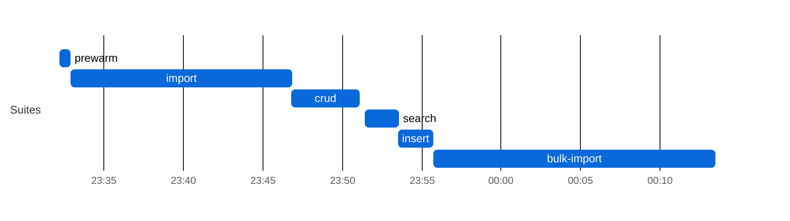
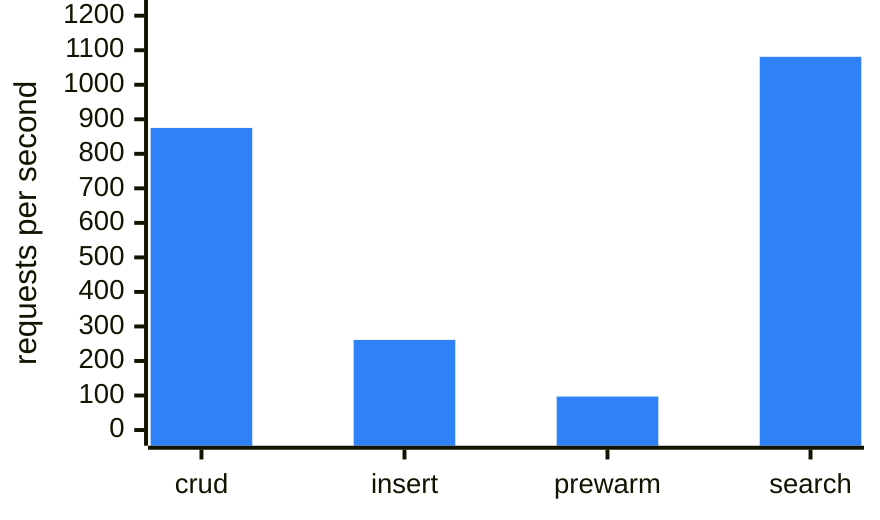
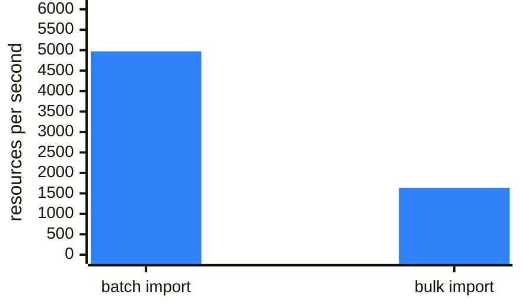

### MongoDB tuning (mongodb-elasticsearch)

| setting | value |
|---|---|
| image | `mongo:7.0` — single-member replica set `rs0`, directConnection |
| --wiredTigerCacheSizeGB | `2` (mongod reports @@WT_MAX_BYTES@@ bytes) |
| transactionLifetimeLimitSeconds | `@@TXN_LIFETIME@@` |
| --oplogSize | `2048MB` |
| HFS_MONGODB_MAX_CONNECTIONS | `32` |
| HFS_MONGODB_DATABASE | `hfs_bench` |
| data volume free space (start) | `173144 MB` |
### Elasticsearch tuning (mongodb-elasticsearch)

| setting | value |
|---|---|
| image | `elasticsearch:8.15.0` (reports @@ES_VERSION@@), single node |
| JVM heap (-Xms = -Xmx) | `1024m` |
| HFS_COMPOSITE_SYNC_MODE | `synchronous` |
| HFS_ELASTICSEARCH_WRITE_REFRESH | `wait_for` |
| HFS_ELASTICSEARCH_REFRESH_INTERVAL | `200ms` |
| HFS_COMPOSITE_SYNC_REPAIR_INTERVAL | `60` |
| index replicas | 1 (hardcoded default in HFS) — cluster **yellow** on one node is expected |
| data volume free space (start) | `173112 MB (15% used)` |
### Search latency by query shape (mongodb-elasticsearch)
| Query shape | n | median (ms) | p95 (ms) | max (ms) |
|---|---:|---:|---:|---:|
| `date Observation?date` | 5424 | 50 | 101 | 444 |
| `quantity Observation?combo-value-quantity` | 5424 | 44 | 93 | 366 |
| `quantity Observation?value-quantity` | 5424 | 39 | 89 | 335 |
| `token Observation?category` | 5424 | 34 | 72 | 521 |
| `quantity Observation?component-value-quantity` | 5424 | 38 | 66 | 318 |
| `date Encounter?date` | 5424 | 26 | 49 | 336 |
| `composite Observation?code-value-quantity` | 5424 | 25 | 48 | 338 |
| `token Observation?code` | 5424 | 26 | 48 | 253 |
| `composite Observation?component-code-value-quantity` | 5424 | 23 | 45 | 337 |
| `composite Observation?combo-code-value-quantity` | 5424 | 23 | 45 | 261 |
| `token Encounter?class` | 5424 | 23 | 44 | 243 |
| `string Organization?name` | 5424 | 23 | 44 | 258 |
| `date Patient?birthdate` | 5424 | 23 | 44 | 256 |
| `reference Encounter?subject` | 5424 | 22 | 43 | 256 |
| `token Encounter?status` | 5424 | 22 | 43 | 254 |
| `reference Observation?subject` | 5424 | 21 | 43 | 141 |
| `string Patient?address` | 5424 | 21 | 42 | 153 |
| `reference Encounter?participant` | 5424 | 21 | 42 | 245 |
| `reference MedicationRequest?encounter` | 5424 | 20 | 41 | 195 |
| `reference MedicationRequest?requester` | 5424 | 20 | 41 | 255 |
| `string Patient?name` | 5424 | 20 | 41 | 207 |
| `reference MedicationRequest?subject` | 5424 | 20 | 41 | 179 |
| `reference Observation?encounter` | 5424 | 19 | 40 | 197 |
| `reference Observation?performer` | 5424 | 18 | 39 | 253 |
| `? ??http://localhost:8086/Encounter?_count=20&_elements=id` | 1 | 23 | 23 | 23 |
| `? ??http://localhost:8086/Patient?_count=20&_elements=id` | 1 | 10 | 10 | 10 |
| `? ??http://localhost:8086/Practitioner?_count=20&_elements=id` | 1 | 5 | 5 | 5 |
## FHIR Benchmark — `main` (mongodb-elasticsearch)

| | |
|---|---|
| **Commit**  | `e0bd5cb` |
| **Backend** | `mongodb-elasticsearch` |
| **Suites**  | all |

### Leg configuration

| | |
|---|---|
| **Backend** | `mongodb-elasticsearch` |
| **ES heap** | `1g` |
| **ES sync mode** | `synchronous` |
| **Mongo WT cache** | `2` GB |
| **Mongo pool max** | `32` |
| **Legs at once (max_parallel)** | 1 |
| **Leg timeout** | 150 min |
| **Capacity gate** | need 5632 MB, available 17377 MB (source `docker-stats`), waited 2 s |

**Batch/Transaction Import** (`POST /` Bundles): 996/1000 bundles, 1,465,188 entries in 826 s — **4,972 resources/s** (3.38 Bundles/s) over the 295 s import scenario, after 531 s of k6 setup() (the two seed Bundles). ⚠ **Batch/Transaction Import incomplete — crud/search on this leg ran on a smaller corpus and are not comparable to a 1000/1000 leg** (and abandoned Batch/Transaction Import requests may still have been running server-side)

**Bulk Import (`$bulk-submit`):** 1,630,685/1,630,685 resources in 995.5 s (ingest until Completed 645.3 s + search-index rebuild 350.2 s, `completed`) = **1638.1 resources/s** end to end, 2527.0 resources/s ingest only; fresh database, `defer_indexing=true`.

Search check against the converted corpus: Patient 1,000/1,000 · Observation 689,080/689,080 · `Observation?code=8302-2,29463-7` 33,473/33,473 · `Encounter?class=AMB,EMER` 65,900/65,900 ✓

**ES drain:** status=`drained` (barrier HTTP 204 after 0 s); primary_live=1469914 es_live=1469914 missing=0 needs_reindex=0.

**Host load at crud start:** loadavg 3.86, 23 containers, 11296 MB MemAvailable on the Docker host (source `docker-stats`).

**How to read this leg.** Every search is answered by Elasticsearch; the primary's own search index is not written. In `synchronous` mode a write returns only after Elasticsearch has indexed it — bundles go through a per-resource-type `_bulk` request with `refresh=wait_for` against a 200ms `refresh_interval`, so **Batch/Transaction Import/crud/insert latency on this leg includes Elasticsearch indexing plus that refresh wait**, not just the primary. Every update and delete also runs a `_delete_by_query` with a forced refresh across all of the tenant's indices. Cluster health `yellow` is expected (1 replica per index, 1 node). Compare search latency with another leg only if both imported the same entry count and the ES drain above says `drained`.

**How to read this leg.** MongoDB 7.0 single-member replica set (directConnection); WiredTiger cache **2 GB** (Postgres: shared_buffers 2GB; both also use the host page cache). Each FHIR transaction bundle is one multi-document transaction (lifetime 900 s); an aborted transaction fails that bundle's `Bundle import` check — see Checks ✗ on the Batch/Transaction Import row (in Results, below) and `txn.aborted` in `import-mongostat.txt`.

### Result-size cross-check

| Query | Total | HTTP | Seconds |
|---|---:|---:|---:|
| `Patient?_summary=count` | 996 | 200 | 0 |
| `Observation?_summary=count` | 626637 | 200 | 0 |
| `Encounter?_summary=count` | 62962 | 200 | 0 |
| `Patient?name:contains=an&_summary=count` | 353 | 200 | 0 |
| `Observation?date=ge2020-01-01&_summary=count` | 296434 | 200 | 0 |
| `Observation?date=sa2020-01-01&_summary=count` | 296214 | 200 | 0 |
| `Observation?code=8302-2,29463-7&_summary=count` | 31961 | 200 | 0 |
| `Observation?value-quantity=gt100&_summary=count` | 91647 | 200 | 0 |
| `Observation?value-quantity=sa100&_summary=count` | 91647 | 200 | 0 |
| `Observation?code-value-quantity=http://loinc.org%7C8867-4$gt100&_summary=count` | 222 | 200 | 0 |
| `Observation?combo-code-value-quantity=8480-6$gt140&_summary=count` | 1003 | 200 | 0 |
| `Encounter?class=AMB,EMER&_summary=count` | 61208 | 200 | 0 |

_totals include 0 crud/prewarm leftovers (Patient: 0) and any Batch/Transaction Import shortfall; a composite total equal to the Observation total means the name-only fallback; seconds after a 000 row overlap the previous query (HFS keeps executing after curl's --max-time)._

**Insert:** 31,565 create requests by 50 VUs, 261/s — Patient 6,313 created (p95 263.8 ms) · Observation 25,252 created (p95 243.6 ms). HFS's own suite (`.github/scripts/fhir-bench/k6/insert.js`, load shape in its header); it ran last, after the result-size snapshot, so its resources are not in those totals.
### Results

| Suite | Throughput | p50 ms | p95 ms | p99 ms | Err% | Checks ✓/✗ |
|-------|----:|-------:|-------:|-------:|-----:|-----------:|
| crud | 875 | 339.9 | 825.6 | 1042.0 | 0.0% | 216,000/0 |
| Batch/Transaction Import (`/ui/batch`: `POST /` Bundles) (resources/s; latency per Bundle) | 4,972 | 4188.9 | 13450.4 | 24764.3 | 0.2% | **996/4** |
| Bulk Import (`/ui/bulk-import`: `$bulk-submit`, until searchable) (resources/s) | 1,638 | n/a | n/a | n/a | 0.0% | n/a |
| insert | 261 | 205.4 | 250.3 | 270.2 | 0.0% | 31,565/0 |
| prewarm | 97 | 90.0 | 304.3 | 388.9 | 0.0% | 3,240/0 |
| search | 1,081 | 24.3 | 60.6 | 92.2 | 0.0% | 130,176/0 |

_Throughput is requests/s and latency is per request, except on the Batch/Transaction Import row (resources/s and per-Bundle latency, see the **Import** line above; k6 drives it with 20 concurrent clients); the Bulk Import row is resources/s end to end until searchable, with no per-request latency (see the **Bulk Import** line above)._

### Charts

Chart: mongodb-elasticsearch run phases (UTC)

**mongodb-elasticsearch: run phases (UTC)**

Each bar is one suite of this leg, from its start to its end (UTC, from host-contention.txt); gaps are setup between suites.

Chart: mongodb-elasticsearch throughput and latency

<table>
<tr>
<td valign="top">

**mongodb-elasticsearch: k6 suites throughput (requests/s)**

One bar per k6 suite, higher is better; values in the Results table above.

</td>
<td valign="top">

**mongodb-elasticsearch: Import throughput (resources/s)**

One bar per way of loading the corpus, higher is better; values in the Results table above (batch: committed Bundle entries per second of the k6 scenario; bulk: resources until the search index covers them).

</td>
</tr>
</table>

**mongodb-elasticsearch: latency per suite (ms)**

Overlaid bars per suite, light to dark blue: p99 (back), p95, p50 (front); lower is better; values in the Results table above (import, per Bundle, is left out).

```mermaid
%%{init: {"xyChart": {"width": 540, "height": 260, "useMaxWidth": false}, "themeVariables": {"xyChart": {"plotColorPalette": "#54aeff, #2f81f7, #0969da", "backgroundColor": "transparent"}}}}%%
xychart-beta
    x-axis ["crud", "insert", "prewarm", "search"]
    y-axis "ms" 0 --> 1200
    bar [1042, 270.2, 388.9, 92.2]
    bar [825.6, 250.3, 304.3, 60.6]
    bar [339.9, 205.4, 90, 24.3]
```

