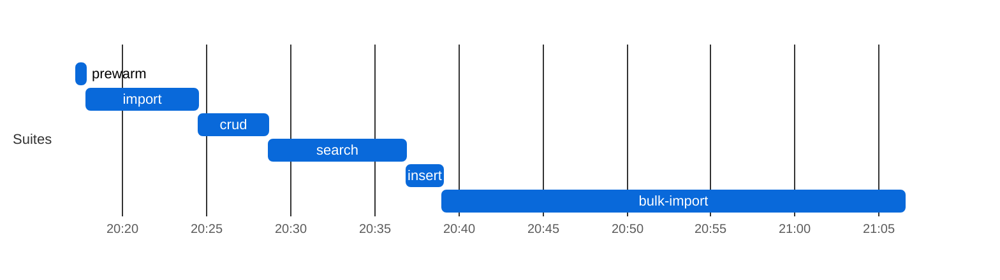
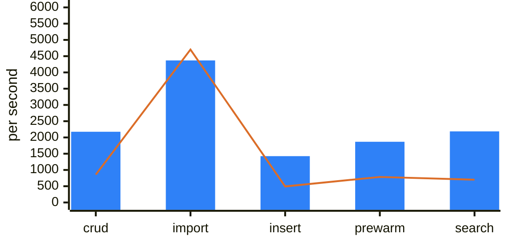

### Postgres tuning (postgres)

| setting | value |
|---|---|
| Docker host RAM | 19G |
| shared_buffers | `2GB` |
| effective_cache_size | `6GB` |
| work_mem | `10MB` |
| max_wal_size | `8GB` |
| min_wal_size | `2GB` |
| wal_buffers | `256MB` |
| checkpoint_timeout | `15min` |
| data volume free space (start) | `173450 MB` |
### Search latency by query shape (postgres)
| Query shape | n | median (ms) | p95 (ms) | max (ms) |
|---|---:|---:|---:|---:|
| `composite Observation?code-value-quantity` | 10953 | 18 | 175 | 707 |
| `composite Observation?component-code-value-quantity` | 10953 | 12 | 164 | 1593 |
| `string Patient?address` | 10953 | 11 | 59 | 3662 |
| `composite Observation?combo-code-value-quantity` | 10953 | 11 | 58 | 369 |
| `string Patient?name` | 10953 | 9 | 47 | 494 |
| `? ??http://localhost:8082/Patient?_count=20&_elements=id` | 1 | 41 | 41 | 41 |
| `reference MedicationRequest?requester` | 10953 | 7 | 37 | 1132 |
| `quantity Observation?component-value-quantity` | 10953 | 11 | 37 | 273 |
| `quantity Observation?combo-value-quantity` | 10953 | 9 | 36 | 375 |
| `date Encounter?date` | 10953 | 6 | 35 | 349 |
| `reference Observation?subject` | 10953 | 8 | 34 | 354 |
| `quantity Observation?value-quantity` | 10953 | 9 | 34 | 459 |
| `date Observation?date` | 10953 | 7 | 33 | 3953 |
| `reference Encounter?participant` | 10953 | 7 | 28 | 514 |
| `token Observation?code` | 10953 | 7 | 28 | 290 |
| `token Observation?category` | 10953 | 7 | 27 | 316 |
| `token Encounter?class` | 10953 | 7 | 27 | 26509 |
| `date Patient?birthdate` | 10953 | 7 | 26 | 293 |
| `reference Encounter?subject` | 10953 | 7 | 26 | 317 |
| `token Encounter?status` | 10953 | 6 | 25 | 316 |
| `reference MedicationRequest?subject` | 10953 | 6 | 25 | 308 |
| `reference Observation?encounter` | 10953 | 6 | 24 | 259 |
| `string Organization?name` | 10953 | 6 | 24 | 352 |
| `reference MedicationRequest?encounter` | 10953 | 5 | 22 | 317 |
| `reference Observation?performer` | 10953 | 5 | 22 | 339 |
| `? ??http://localhost:8082/Practitioner?_count=20&_elements=id` | 1 | 12 | 12 | 12 |
| `? ??http://localhost:8082/Encounter?_count=20&_elements=id` | 1 | 3 | 3 | 3 |
## FHIR Benchmark — `main` (postgres)

| | |
|---|---|
| **Commit**  | `e0bd5cb` |
| **Backend** | `postgres` |
| **Suites**  | all |

### Leg configuration

| | |
|---|---|
| **Backend** | `postgres` |
| **Legs at once (max_parallel)** | 1 |
| **Leg timeout** | 150 min |
| **Capacity gate** | need 3584 MB, available 18141 MB (source `docker-stats`), waited 2 s |

**Batch/Transaction Import** (`POST /` Bundles): 1,000/1000 bundles, 1,627,336 entries in 393 s — **4,369 resources/s** (2.68 Bundles/s) over the 372 s import scenario, after 20 s of k6 setup() (the two seed Bundles).

**Bulk Import (`$bulk-submit`):** 1,630,685/1,630,685 resources in 1564.2 s (ingest until Completed 510.3 s + search-index rebuild 1053.9 s, `completed`) = **1042.5 resources/s** end to end, 3195.5 resources/s ingest only; fresh database, `defer_indexing=true`.

Search check against the converted corpus: Patient 1,000/1,000 · Observation 689,080/689,080 · `Observation?code=8302-2,29463-7` 33,473/33,473 · `Encounter?class=AMB,EMER` 65,900/65,900 ✓

**Host load at crud start:** loadavg 11.99, 33 containers, 12039 MB MemAvailable on the Docker host (source `docker-stats`).

### Result-size cross-check

| Query | Total | HTTP | Seconds |
|---|---:|---:|---:|
| `Patient?_summary=count` | 1000 | 200 | 0 |
| `Observation?_summary=count` | 689080 | 200 | 0 |
| `Encounter?_summary=count` | 67692 | 200 | 0 |
| `Patient?name:contains=an&_summary=count` | 353 | 200 | 0 |
| `Observation?date=ge2020-01-01&_summary=count` | 327171 | 200 | 1 |
| `Observation?date=sa2020-01-01&_summary=count` | 326951 | 200 | 1 |
| `Observation?code=8302-2,29463-7&_summary=count` | 33473 | 200 | 0 |
| `Observation?value-quantity=gt100&_summary=count` | 101155 | 200 | 0 |
| `Observation?value-quantity=sa100&_summary=count` | 101155 | 200 | 1 |
| `Observation?code-value-quantity=http://loinc.org%7C8867-4$gt100&_summary=count` | 222 | 200 | 0 |
| `Observation?combo-code-value-quantity=8480-6$gt140&_summary=count` | 1009 | 200 | 0 |
| `Encounter?class=AMB,EMER&_summary=count` | 65900 | 200 | 0 |

_totals include 0 crud/prewarm leftovers (Patient: 0) and any Batch/Transaction Import shortfall; a composite total equal to the Observation total means the name-only fallback; seconds after a 000 row overlap the previous query (HFS keeps executing after curl's --max-time)._

**Insert:** 171,220 create requests by 50 VUs, 1,425/s — Patient 34,244 created (p95 57.8 ms) · Observation 136,976 created (p95 57.6 ms). HFS's own suite (`.github/scripts/fhir-bench/k6/insert.js`, load shape in its header); it ran last, after the result-size snapshot, so its resources are not in those totals.
### Results

| Suite | Throughput | p50 ms | p95 ms | p99 ms | Err% | Checks ✓/✗ |
|-------|----:|-------:|-------:|-------:|-----:|-----------:|
| crud | 2,175 | 122.7 | 290.0 | 415.7 | 0.0% | 526,680/0 |
| Batch/Transaction Import (`/ui/batch`: `POST /` Bundles, 20 concurrent clients) (resources/s; latency per Bundle) | 4,369 | 2673.3 | 26629.8 | 66378.2 | 0.0% | 1,000/0 |
| insert | 1,425 | 31.9 | 57.7 | 102.9 | 0.0% | 171,220/0 |
| prewarm | 1,867 | 5.7 | 11.6 | 16.0 | 0.0% | 56,520/0 |
| search | 2,186 | 7.7 | 40.4 | 114.4 | 0.0% | 262,872/0 |

_Throughput is requests/s and latency is per request, except on the Batch/Transaction Import row (resources/s and per-Bundle latency, see the **Import** line above)._

**Environment:** crud Postgres cost **0.19 ms/call** (802 s over 4,258,777 statements, host loadavg 11.99 over 33 containers at crud start).

### Charts

Chart: postgres run phases (UTC)

**postgres: run phases (UTC)**

Each bar is one suite of this leg, from its start to its end (UTC, from host-contention.txt); gaps are setup between suites.

Chart: postgres throughput and latency

**postgres: throughput per suite**

One bar per suite, higher is better; values in the Results table above (import is resources/s, the others requests/s); the orange line is the same leg in run 38564965562.

**postgres: latency per suite (ms)**

Overlaid bars per suite, light to dark blue: p99 (back), p95, p50 (front); lower is better; values in the Results table above (import, per Bundle, is left out). Values span more than 50x; read small ones in the table.

```mermaid
%%{init: {"xyChart": {"width": 540, "height": 260, "useMaxWidth": false}, "themeVariables": {"xyChart": {"plotColorPalette": "#54aeff, #2f81f7, #0969da", "backgroundColor": "transparent"}}}}%%
xychart-beta
    x-axis ["crud", "insert", "prewarm", "search"]
    y-axis "ms" 0 --> 500
    bar [415.7, 102.9, 16, 114.4]
    bar [290, 57.7, 11.6, 40.4]
    bar [122.7, 31.9, 5.7, 7.7]
```

