## FHIR Benchmark — `main` (sqlite)

| | |
|---|---|
| **Commit**  | `e0bd5cb` |
| **Backend** | `sqlite` |
| **Suites**  | all |

### Leg configuration

| | |
|---|---|
| **Backend** | `sqlite` |
| **Legs at once (max_parallel)** | 1 |
| **Leg timeout** | 150 min |
| **Capacity gate** | need 512 MB, available 16746 MB (source `docker-stats`), waited 2 s |


**Batch/Transaction Import** (`POST /` Bundles): 922/1000 bundles, 1,527,543 entries in 1365 s — **1,122 resources/s** (0.68 Bundles/s) over the 1,361 s import scenario, after 5 s of k6 setup() (the two seed Bundles). ⚠ **Batch/Transaction Import incomplete — crud/search on this leg ran on a smaller corpus and are not comparable to a 1000/1000 leg** (and abandoned Batch/Transaction Import requests may still have been running server-side)

**Bulk Import (`$bulk-submit`):** 1,630,685/1,630,685 resources in 1453.9 s (Bulk Import: ingest 355.2 s + Bulk Import: index rebuild 1098.7 s, `completed`) = **1121.6 resources/s** end to end, 4590.9 resources/s ingest only; fresh database, `defer_indexing=true`.

Search check against the converted corpus: Patient 1,000/1,000 · Observation 689,080/689,080 · `Observation?code=8302-2,29463-7` 33,473/33,473 · `Encounter?class=AMB,EMER` 65,900/65,900 ✓

**Host load at crud start:** loadavg 5.75, 17 containers, 14773 MB MemAvailable on the Docker host (source `docker-stats`).

### Result-size cross-check

| Query | Total | HTTP | Seconds |
|---|---:|---:|---:|
| `Patient?_summary=count` | 922 | 200 | 3 |
| `Observation?_summary=count` | 657369 | 200 | 1 |
| `Encounter?_summary=count` | 63316 | 200 | 0 |
| `Patient?name:contains=an&_summary=count` | 330 | 200 | 0 |
| `Observation?date=ge2020-01-01&_summary=count` | 307405 | 200 | 3 |
| `Observation?date=sa2020-01-01&_summary=count` | 307197 | 200 | 1 |
| `Observation?code=8302-2,29463-7&_summary=count` | 31506 | 200 | 3 |
| `Observation?value-quantity=gt100&_summary=count` | 95724 | 200 | 6 |
| `Observation?value-quantity=sa100&_summary=count` | 95724 | 200 | 5 |
| `Observation?code-value-quantity=http://loinc.org%7C8867-4$gt100&_summary=count` | 217 | 200 | 7 |
| `Observation?combo-code-value-quantity=8480-6$gt140&_summary=count` | 922 | 200 | 8 |
| `Encounter?class=AMB,EMER&_summary=count` | 61602 | 200 | 2 |

_totals include 0 crud/prewarm leftovers (Patient: 0) and any Batch/Transaction Import shortfall; a composite total equal to the Observation total means the name-only fallback; seconds after a 000 row overlap the previous query (HFS keeps executing after curl's --max-time)._

**Insert:** 102,415 create requests by 50 VUs, 827/s — Patient 20,483 created (p95 115.1 ms) · Observation 81,932 created (p95 113.0 ms). HFS's own suite (`.github/scripts/fhir-bench/k6/insert.js`, load shape in its header); it ran last, after the result-size snapshot, so its resources are not in those totals.

<details><summary>Chart: sqlite run phases (UTC)</summary>

**sqlite: run phases (UTC)**

Each bar is one suite of this leg, from its start to its end (UTC, from host-contention.txt); gaps are setup between suites.

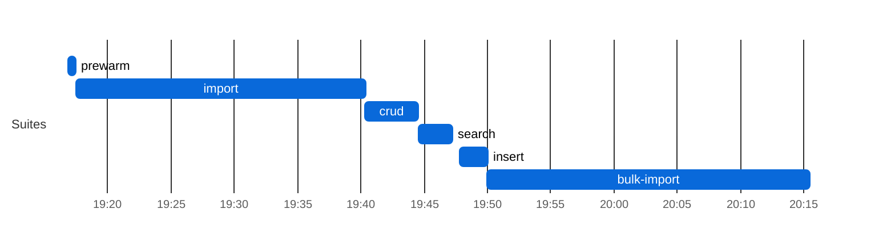

</details>

### Results

| Suite | Throughput | p50 ms | p95 ms | p99 ms | Err% | Checks ✓/✗ |
|-------|----:|-------:|-------:|-------:|-----:|-----------:|
| crud | 1,132 | 142.1 | 902.2 | 1606.3 | 0.0% | 279,612/0 |
| Batch/Transaction Import, `POST /` Bundles (resources/s; latency per Bundle) | 1,122 | 21619.7 | 60259.9 | 88429.5 | **3.9%** | **922/78** |
| insert | 827 | 45.4 | 113.3 | 374.3 | 0.0% | 102,415/0 |
| prewarm | 1,475 | 2.0 | 20.6 | 93.3 | 0.0% | 44,496/0 |
| search | 4 | 5625.7 | 17373.9 | 32468.8 | 0.0% | 554/0 |

<details><summary>Chart: sqlite throughput and latency</summary>

**sqlite: throughput per suite**

One bar per suite, higher is better; values in the table above (import is resources/s, the others requests/s); values span more than 50x, so read short bars in the table.

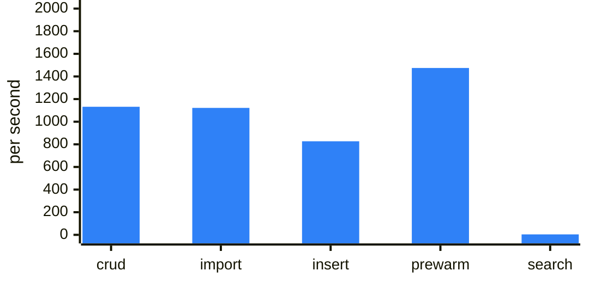

**sqlite: latency per suite (ms)**

Overlaid bars per suite, light to dark blue: p99 (back), p95, p50 (front); lower is better; values in the table above (import, per Bundle, is left out). Values span more than 50x; read small ones in the table.

```mermaid
%%{init: {"xyChart": {"width": 540, "height": 260, "useMaxWidth": false}, "themeVariables": {"xyChart": {"plotColorPalette": "#54aeff, #2f81f7, #0969da", "backgroundColor": "transparent"}}}}%%
xychart-beta
    x-axis ["crud", "insert", "prewarm", "search"]
    y-axis "ms" 0 --> 40000
    bar [1606.3, 374.3, 93.3, 32468.8]
    bar [902.2, 113.3, 20.6, 17373.9]
    bar [142.1, 45.4, 2, 5625.7]
```

</details>

_Throughput is requests/s and latency is per request, except on the Batch/Transaction Import row (resources/s and per-Bundle latency, see the **Import** line above)._

---

## FHIR Benchmark — `main` (postgres)

| | |
|---|---|
| **Commit**  | `e0bd5cb` |
| **Backend** | `postgres` |
| **Suites**  | all |

### Leg configuration

| | |
|---|---|
| **Backend** | `postgres` |
| **Legs at once (max_parallel)** | 1 |
| **Leg timeout** | 150 min |
| **Capacity gate** | need 3584 MB, available 18141 MB (source `docker-stats`), waited 2 s |


**Batch/Transaction Import** (`POST /` Bundles): 1,000/1000 bundles, 1,627,336 entries in 393 s — **4,369 resources/s** (2.68 Bundles/s) over the 372 s import scenario, after 20 s of k6 setup() (the two seed Bundles).

**Bulk Import (`$bulk-submit`):** 1,630,685/1,630,685 resources in 1564.2 s (Bulk Import: ingest 510.3 s + Bulk Import: index rebuild 1053.9 s, `completed`) = **1042.5 resources/s** end to end, 3195.5 resources/s ingest only; fresh database, `defer_indexing=true`.

Search check against the converted corpus: Patient 1,000/1,000 · Observation 689,080/689,080 · `Observation?code=8302-2,29463-7` 33,473/33,473 · `Encounter?class=AMB,EMER` 65,900/65,900 ✓

**Host load at crud start:** loadavg 11.99, 33 containers, 12039 MB MemAvailable on the Docker host (source `docker-stats`).

### Result-size cross-check

| Query | Total | HTTP | Seconds |
|---|---:|---:|---:|
| `Patient?_summary=count` | 1000 | 200 | 0 |
| `Observation?_summary=count` | 689080 | 200 | 0 |
| `Encounter?_summary=count` | 67692 | 200 | 0 |
| `Patient?name:contains=an&_summary=count` | 353 | 200 | 0 |
| `Observation?date=ge2020-01-01&_summary=count` | 327171 | 200 | 1 |
| `Observation?date=sa2020-01-01&_summary=count` | 326951 | 200 | 1 |
| `Observation?code=8302-2,29463-7&_summary=count` | 33473 | 200 | 0 |
| `Observation?value-quantity=gt100&_summary=count` | 101155 | 200 | 0 |
| `Observation?value-quantity=sa100&_summary=count` | 101155 | 200 | 1 |
| `Observation?code-value-quantity=http://loinc.org%7C8867-4$gt100&_summary=count` | 222 | 200 | 0 |
| `Observation?combo-code-value-quantity=8480-6$gt140&_summary=count` | 1009 | 200 | 0 |
| `Encounter?class=AMB,EMER&_summary=count` | 65900 | 200 | 0 |

_totals include 0 crud/prewarm leftovers (Patient: 0) and any Batch/Transaction Import shortfall; a composite total equal to the Observation total means the name-only fallback; seconds after a 000 row overlap the previous query (HFS keeps executing after curl's --max-time)._

**Insert:** 171,220 create requests by 50 VUs, 1,425/s — Patient 34,244 created (p95 57.8 ms) · Observation 136,976 created (p95 57.6 ms). HFS's own suite (`.github/scripts/fhir-bench/k6/insert.js`, load shape in its header); it ran last, after the result-size snapshot, so its resources are not in those totals.

<details><summary>Chart: postgres run phases (UTC)</summary>

**postgres: run phases (UTC)**

Each bar is one suite of this leg, from its start to its end (UTC, from host-contention.txt); gaps are setup between suites.

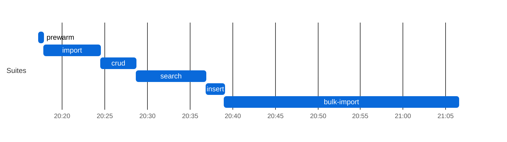

</details>

### Results

| Suite | Throughput | p50 ms | p95 ms | p99 ms | Err% | Checks ✓/✗ |
|-------|----:|-------:|-------:|-------:|-----:|-----------:|
| crud | 2,175 | 122.7 | 290.0 | 415.7 | 0.0% | 526,680/0 |
| Batch/Transaction Import, `POST /` Bundles (resources/s; latency per Bundle) | 4,369 | 2673.3 | 26629.8 | 66378.2 | 0.0% | 1,000/0 |
| insert | 1,425 | 31.9 | 57.7 | 102.9 | 0.0% | 171,220/0 |
| prewarm | 1,867 | 5.7 | 11.6 | 16.0 | 0.0% | 56,520/0 |
| search | 2,186 | 7.7 | 40.4 | 114.4 | 0.0% | 262,872/0 |

<details><summary>Chart: postgres throughput and latency</summary>

**postgres: throughput per suite**

One bar per suite, higher is better; values in the table above (import is resources/s, the others requests/s); the orange line is the same leg in run 38564965562.

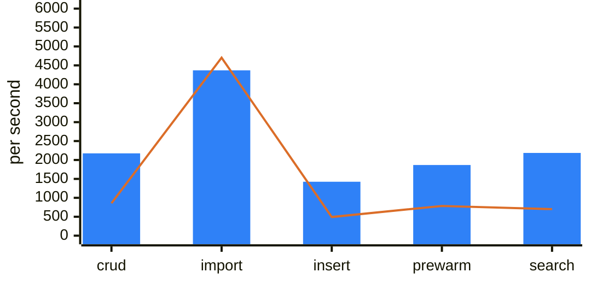

**postgres: latency per suite (ms)**

Overlaid bars per suite, light to dark blue: p99 (back), p95, p50 (front); lower is better; values in the table above (import, per Bundle, is left out). Values span more than 50x; read small ones in the table.

```mermaid
%%{init: {"xyChart": {"width": 540, "height": 260, "useMaxWidth": false}, "themeVariables": {"xyChart": {"plotColorPalette": "#54aeff, #2f81f7, #0969da", "backgroundColor": "transparent"}}}}%%
xychart-beta
    x-axis ["crud", "insert", "prewarm", "search"]
    y-axis "ms" 0 --> 500
    bar [415.7, 102.9, 16, 114.4]
    bar [290, 57.7, 11.6, 40.4]
    bar [122.7, 31.9, 5.7, 7.7]
```

</details>

_Throughput is requests/s and latency is per request, except on the Batch/Transaction Import row (resources/s and per-Bundle latency, see the **Import** line above)._

**Environment:** crud Postgres cost **0.19 ms/call** (802 s over 4,258,777 statements, host loadavg 11.99 over 33 containers at crud start).

---

## FHIR Benchmark — `main` (mongodb)

| | |
|---|---|
| **Commit**  | `e0bd5cb` |
| **Backend** | `mongodb` |
| **Suites**  | all |

### Leg configuration

| | |
|---|---|
| **Backend** | `mongodb` |
| **Mongo WT cache** | `2` GB |
| **Mongo pool max** | `32` |
| **Legs at once (max_parallel)** | 1 |
| **Leg timeout** | 150 min |
| **Capacity gate** | need 3072 MB, available 10923 MB (source `docker-stats`), waited 2 s |


**Batch/Transaction Import** (`POST /` Bundles): 989/1000 bundles, 1,312,554 entries in 1115 s — **1,201 resources/s** (0.90 Bundles/s) over the 1,093 s import scenario, after 22 s of k6 setup() (the two seed Bundles). ⚠ **Batch/Transaction Import incomplete — crud/search on this leg ran on a smaller corpus and are not comparable to a 1000/1000 leg** (and abandoned Batch/Transaction Import requests may still have been running server-side)

**Bulk Import (`$bulk-submit`):** 1,630,685/1,630,685 resources in 2628.3 s (Bulk Import: ingest 930.5 s + Bulk Import: index rebuild 1697.8 s, `completed`) = **620.4 resources/s** end to end, 1752.5 resources/s ingest only; fresh database, `defer_indexing=true`.

Search check against the converted corpus: Patient 1,000/1,000 · Observation 689,080/689,080 · `Observation?code=8302-2,29463-7` 33,473/33,473 · `Encounter?class=AMB,EMER` 65,900/65,900 ✓

**Host load at crud start:** loadavg 5.51, 53 containers, 6341 MB MemAvailable on the Docker host (source `docker-stats`).

**How to read this leg.** MongoDB 7.0 single-member replica set (directConnection); WiredTiger cache **2 GB** (Postgres: shared_buffers 2GB; both also use the host page cache). Each FHIR transaction bundle is one multi-document transaction (lifetime 900 s); an aborted transaction fails that bundle's `Bundle import` check — see Checks ✗ on the Batch/Transaction Import row (in Results, below) and `txn.aborted` in `import-mongostat.txt`.

### Result-size cross-check

| Query | Total | HTTP | Seconds |
|---|---:|---:|---:|
| `Patient?_summary=count` | 989 | 200 | 0 |
| `Observation?_summary=count` | 564051 | 200 | 0 |
| `Encounter?_summary=count` | 56497 | 200 | 0 |
| `Patient?name:contains=an&_summary=count` | 348 | 200 | 0 |
| `Observation?date=ge2020-01-01&_summary=count` | 269919 | 200 | 3 |
| `Observation?date=sa2020-01-01&_summary=count` | 269734 | 200 | 1 |
| `Observation?code=8302-2,29463-7&_summary=count` | 30291 | 200 | 1 |
| `Observation?value-quantity=gt100&_summary=count` | 83180 | 200 | 1 |
| `Observation?value-quantity=sa100&_summary=count` | 83180 | 200 | 1 |
| `Observation?code-value-quantity=http://loinc.org%7C8867-4$gt100&_summary=count` | 222 | 200 | 3 |
| `Observation?combo-code-value-quantity=8480-6$gt140&_summary=count` | 1003 | 200 | 2 |
| `Encounter?class=AMB,EMER&_summary=count` | 54762 | 200 | 2 |

_totals include 0 crud/prewarm leftovers (Patient: 0) and any Batch/Transaction Import shortfall; a composite total equal to the Observation total means the name-only fallback; seconds after a 000 row overlap the previous query (HFS keeps executing after curl's --max-time)._

**Insert:** 140,190 create requests by 50 VUs, 1,167/s — Patient 28,038 created (p95 70.7 ms) · Observation 112,152 created (p95 71.1 ms). HFS's own suite (`.github/scripts/fhir-bench/k6/insert.js`, load shape in its header); it ran last, after the result-size snapshot, so its resources are not in those totals.

⚠ **Mongo transaction errors (heuristic):** 12 HFS log line(s) matching WriteConflict/TransientTransactionError/TransactionTooLargeForCache/NoSuchTransaction/commit-failed — bundle failures are the Batch/Transaction Import row's Checks ✗ (in Results, below), not this count.

<details><summary>Chart: mongodb run phases (UTC)</summary>

**mongodb: run phases (UTC)**

Each bar is one suite of this leg, from its start to its end (UTC, from host-contention.txt); gaps are setup between suites.

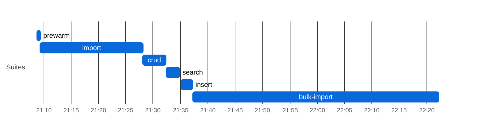

</details>

### Results

| Suite | Throughput | p50 ms | p95 ms | p99 ms | Err% | Checks ✓/✗ |
|-------|----:|-------:|-------:|-------:|-----:|-----------:|
| crud | 1,539 | 206.3 | 380.0 | 536.7 | 0.0% | 377,856/0 |
| Batch/Transaction Import, `POST /` Bundles (resources/s; latency per Bundle) | 1,201 | 18455.1 | 49344.2 | 61241.9 | 0.5% | **989/11** |
| insert | 1,167 | 38.7 | 71.0 | 111.6 | 0.0% | 140,190/0 |
| prewarm | 1,232 | 8.6 | 19.9 | 29.6 | 0.0% | 37,260/0 |
| search | 22 | 137.3 | 9387.3 | 13075.8 | 0.0% | 3,048/0 |

<details><summary>Chart: mongodb throughput and latency</summary>

**mongodb: throughput per suite**

One bar per suite, higher is better; values in the table above (import is resources/s, the others requests/s); values span more than 50x, so read short bars in the table.

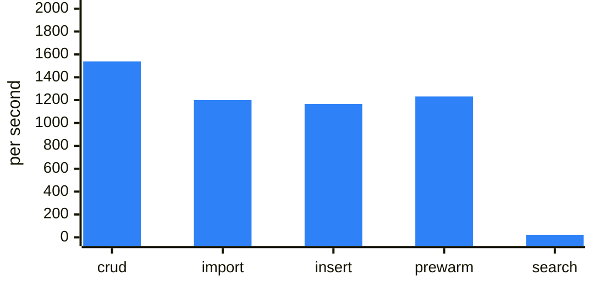

**mongodb: latency per suite (ms)**

Overlaid bars per suite, light to dark blue: p99 (back), p95, p50 (front); lower is better; values in the table above (import, per Bundle, is left out). Values span more than 50x; read small ones in the table.

```mermaid
%%{init: {"xyChart": {"width": 540, "height": 260, "useMaxWidth": false}, "themeVariables": {"xyChart": {"plotColorPalette": "#54aeff, #2f81f7, #0969da", "backgroundColor": "transparent"}}}}%%
xychart-beta
    x-axis ["crud", "insert", "prewarm", "search"]
    y-axis "ms" 0 --> 15000
    bar [536.7, 111.6, 29.6, 13075.8]
    bar [380, 71, 19.9, 9387.3]
    bar [206.3, 38.7, 8.6, 137.3]
```

</details>

_Throughput is requests/s and latency is per request, except on the Batch/Transaction Import row (resources/s and per-Bundle latency, see the **Import** line above)._

---

## FHIR Benchmark — `main` (sqlite-elasticsearch)

| | |
|---|---|
| **Commit**  | `e0bd5cb` |
| **Backend** | `sqlite-elasticsearch` |
| **Suites**  | all |

### Leg configuration

| | |
|---|---|
| **Backend** | `sqlite-elasticsearch` |
| **ES heap** | `1g` |
| **ES sync mode** | `synchronous` |
| **Legs at once (max_parallel)** | 1 |
| **Leg timeout** | 150 min |
| **Capacity gate** | need 3072 MB, available 17404 MB (source `docker-stats`), waited 2 s |


**Batch/Transaction Import** (`POST /` Bundles): 1,000/1000 bundles, 1,627,336 entries in 684 s — **6,325 resources/s** (3.89 Bundles/s) over the 257 s import scenario, after 427 s of k6 setup() (the two seed Bundles).

**Bulk Import (`$bulk-submit`):** 1,630,685/1,630,685 resources in 533.4 s (Bulk Import: ingest 220.1 s + Bulk Import: index rebuild 313.3 s, `completed`) = **3057.2 resources/s** end to end, 7408.8 resources/s ingest only; fresh database, `defer_indexing=true`.

Search check against the converted corpus: Patient 1,000/1,000 · Observation 689,080/689,080 · `Observation?code=8302-2,29463-7` 33,473/33,473 · `Encounter?class=AMB,EMER` 65,900/65,900 ✓

**ES drain:** status=`drained` (barrier HTTP 204 after 0 s); primary_live=1632062 es_live=1632062 missing=0 needs_reindex=0.

**Host load at crud start:** loadavg 6.81, 22 containers, 15265 MB MemAvailable on the Docker host (source `docker-stats`).

**How to read this leg.** Every search is answered by Elasticsearch; the primary's own search index is not written. In `synchronous` mode a write returns only after Elasticsearch has indexed it — bundles go through a per-resource-type `_bulk` request with `refresh=wait_for` against a 200ms `refresh_interval`, so **Batch/Transaction Import/crud/insert latency on this leg includes Elasticsearch indexing plus that refresh wait**, not just the primary. Every update and delete also runs a `_delete_by_query` with a forced refresh across all of the tenant's indices. Cluster health `yellow` is expected (1 replica per index, 1 node). Compare search latency with another leg only if both imported the same entry count and the ES drain above says `drained`.

### Result-size cross-check

| Query | Total | HTTP | Seconds |
|---|---:|---:|---:|
| `Patient?_summary=count` | 1000 | 200 | 0 |
| `Observation?_summary=count` | 689080 | 200 | 0 |
| `Encounter?_summary=count` | 67692 | 200 | 0 |
| `Patient?name:contains=an&_summary=count` | 353 | 200 | 0 |
| `Observation?date=ge2020-01-01&_summary=count` | 327171 | 200 | 0 |
| `Observation?date=sa2020-01-01&_summary=count` | 326951 | 200 | 0 |
| `Observation?code=8302-2,29463-7&_summary=count` | 33473 | 200 | 0 |
| `Observation?value-quantity=gt100&_summary=count` | 101155 | 200 | 0 |
| `Observation?value-quantity=sa100&_summary=count` | 101155 | 200 | 0 |
| `Observation?code-value-quantity=http://loinc.org%7C8867-4$gt100&_summary=count` | 222 | 200 | 0 |
| `Observation?combo-code-value-quantity=8480-6$gt140&_summary=count` | 1009 | 200 | 0 |
| `Encounter?class=AMB,EMER&_summary=count` | 65900 | 200 | 0 |

_totals include 0 crud/prewarm leftovers (Patient: 0) and any Batch/Transaction Import shortfall; a composite total equal to the Observation total means the name-only fallback; seconds after a 000 row overlap the previous query (HFS keeps executing after curl's --max-time)._

**Insert:** 32,230 create requests by 50 VUs, 267/s — Patient 6,446 created (p95 249.8 ms) · Observation 25,784 created (p95 241.8 ms). HFS's own suite (`.github/scripts/fhir-bench/k6/insert.js`, load shape in its header); it ran last, after the result-size snapshot, so its resources are not in those totals.

<details><summary>Chart: sqlite-elasticsearch run phases (UTC)</summary>

**sqlite-elasticsearch: run phases (UTC)**

Each bar is one suite of this leg, from its start to its end (UTC, from host-contention.txt); gaps are setup between suites.

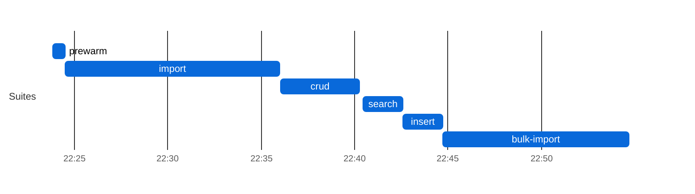

</details>

### Results

| Suite | Throughput | p50 ms | p95 ms | p99 ms | Err% | Checks ✓/✗ |
|-------|----:|-------:|-------:|-------:|-----:|-----------:|
| crud | 995 | 295.1 | 749.2 | 974.0 | 0.0% | 248,112/0 |
| Batch/Transaction Import, `POST /` Bundles (resources/s; latency per Bundle) | 6,325 | 3523.2 | 10268.1 | 24381.4 | 0.0% | 1,000/0 |
| insert | 267 | 203.3 | 243.6 | 260.3 | 0.0% | 32,230/0 |
| prewarm | 90 | 89.8 | 292.3 | 363.9 | 0.0% | 2,988/0 |
| search | 920 | 28.8 | 68.9 | 101.1 | 0.0% | 110,808/0 |

<details><summary>Chart: sqlite-elasticsearch throughput and latency</summary>

**sqlite-elasticsearch: throughput per suite**

One bar per suite, higher is better; values in the table above (import is resources/s, the others requests/s); values span more than 50x, so read short bars in the table.

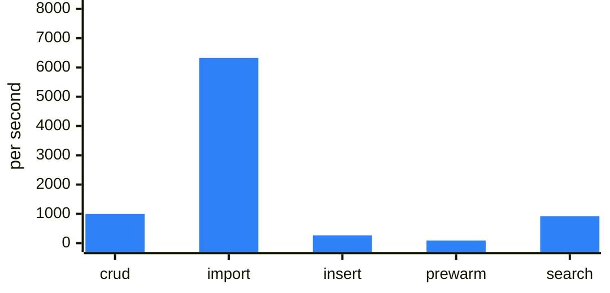

**sqlite-elasticsearch: latency per suite (ms)**

Overlaid bars per suite, light to dark blue: p99 (back), p95, p50 (front); lower is better; values in the table above (import, per Bundle, is left out).

```mermaid
%%{init: {"xyChart": {"width": 540, "height": 260, "useMaxWidth": false}, "themeVariables": {"xyChart": {"plotColorPalette": "#54aeff, #2f81f7, #0969da", "backgroundColor": "transparent"}}}}%%
xychart-beta
    x-axis ["crud", "insert", "prewarm", "search"]
    y-axis "ms" 0 --> 1200
    bar [974, 260.3, 363.9, 101.1]
    bar [749.2, 243.6, 292.3, 68.9]
    bar [295.1, 203.3, 89.8, 28.8]
```

</details>

_Throughput is requests/s and latency is per request, except on the Batch/Transaction Import row (resources/s and per-Bundle latency, see the **Import** line above)._

---

## FHIR Benchmark — `main` (postgres-elasticsearch)

| | |
|---|---|
| **Commit**  | `e0bd5cb` |
| **Backend** | `postgres-elasticsearch` |
| **Suites**  | all |

### Leg configuration

| | |
|---|---|
| **Backend** | `postgres-elasticsearch` |
| **ES heap** | `1g` |
| **ES sync mode** | `synchronous` |
| **Legs at once (max_parallel)** | 1 |
| **Leg timeout** | 150 min |
| **Capacity gate** | need 6144 MB, available 17380 MB (source `docker-stats`), waited 2 s |


**Batch/Transaction Import** (`POST /` Bundles): 1,000/1000 bundles, 1,627,336 entries in 785 s — **6,141 resources/s** (3.77 Bundles/s) over the 265 s import scenario, after 520 s of k6 setup() (the two seed Bundles).

**Bulk Import (`$bulk-submit`):** 1,630,685/1,630,685 resources in 635.8 s (Bulk Import: ingest 315.1 s + Bulk Import: index rebuild 320.7 s, `completed`) = **2564.8 resources/s** end to end, 5175.1 resources/s ingest only; fresh database, `defer_indexing=true`.

Search check against the converted corpus: Patient 1,000/1,000 · Observation 689,080/689,080 · `Observation?code=8302-2,29463-7` 33,473/33,473 · `Encounter?class=AMB,EMER` 65,900/65,900 ✓

**ES drain:** status=`drained` (barrier HTTP 204 after 0 s); primary_live=1632062 es_live=1632062 missing=0 needs_reindex=0.

**Host load at crud start:** loadavg 8.85, 23 containers, 12617 MB MemAvailable on the Docker host (source `docker-stats`).

**How to read this leg.** Every search is answered by Elasticsearch; the primary's own search index is not written. In `synchronous` mode a write returns only after Elasticsearch has indexed it — bundles go through a per-resource-type `_bulk` request with `refresh=wait_for` against a 200ms `refresh_interval`, so **Batch/Transaction Import/crud/insert latency on this leg includes Elasticsearch indexing plus that refresh wait**, not just the primary. Every update and delete also runs a `_delete_by_query` with a forced refresh across all of the tenant's indices. Cluster health `yellow` is expected (1 replica per index, 1 node). Compare search latency with another leg only if both imported the same entry count and the ES drain above says `drained`.

### Result-size cross-check

| Query | Total | HTTP | Seconds |
|---|---:|---:|---:|
| `Patient?_summary=count` | 1000 | 200 | 0 |
| `Observation?_summary=count` | 689080 | 200 | 0 |
| `Encounter?_summary=count` | 67692 | 200 | 0 |
| `Patient?name:contains=an&_summary=count` | 353 | 200 | 0 |
| `Observation?date=ge2020-01-01&_summary=count` | 327171 | 200 | 0 |
| `Observation?date=sa2020-01-01&_summary=count` | 326951 | 200 | 0 |
| `Observation?code=8302-2,29463-7&_summary=count` | 33473 | 200 | 0 |
| `Observation?value-quantity=gt100&_summary=count` | 101155 | 200 | 0 |
| `Observation?value-quantity=sa100&_summary=count` | 101155 | 200 | 0 |
| `Observation?code-value-quantity=http://loinc.org%7C8867-4$gt100&_summary=count` | 222 | 200 | 0 |
| `Observation?combo-code-value-quantity=8480-6$gt140&_summary=count` | 1009 | 200 | 0 |
| `Encounter?class=AMB,EMER&_summary=count` | 65900 | 200 | 0 |

_totals include 0 crud/prewarm leftovers (Patient: 0) and any Batch/Transaction Import shortfall; a composite total equal to the Observation total means the name-only fallback; seconds after a 000 row overlap the previous query (HFS keeps executing after curl's --max-time)._

**Insert:** 31,765 create requests by 50 VUs, 263/s — Patient 6,353 created (p95 257.8 ms) · Observation 25,412 created (p95 242.2 ms). HFS's own suite (`.github/scripts/fhir-bench/k6/insert.js`, load shape in its header); it ran last, after the result-size snapshot, so its resources are not in those totals.

<details><summary>Chart: postgres-elasticsearch run phases (UTC)</summary>

**postgres-elasticsearch: run phases (UTC)**

Each bar is one suite of this leg, from its start to its end (UTC, from host-contention.txt); gaps are setup between suites.

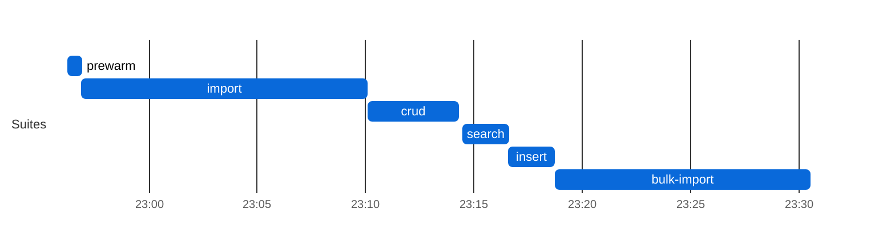

</details>

### Results

| Suite | Throughput | p50 ms | p95 ms | p99 ms | Err% | Checks ✓/✗ |
|-------|----:|-------:|-------:|-------:|-----:|-----------:|
| crud | 879 | 341.7 | 798.6 | 1036.2 | 0.0% | 216,000/0 |
| Batch/Transaction Import, `POST /` Bundles (resources/s; latency per Bundle) | 6,141 | 3486.4 | 10958.2 | 28387.0 | 0.0% | 1,000/0 |
| insert | 263 | 204.7 | 247.1 | 263.2 | 0.0% | 31,765/0 |
| prewarm | 102 | 87.7 | 287.7 | 380.9 | 0.0% | 3,240/0 |
| search | 869 | 30.5 | 73.0 | 108.0 | 0.0% | 104,616/0 |

<details><summary>Chart: postgres-elasticsearch throughput and latency</summary>

**postgres-elasticsearch: throughput per suite**

One bar per suite, higher is better; values in the table above (import is resources/s, the others requests/s); values span more than 50x, so read short bars in the table.

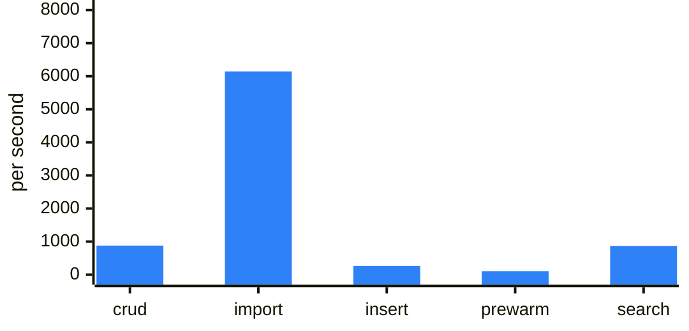

**postgres-elasticsearch: latency per suite (ms)**

Overlaid bars per suite, light to dark blue: p99 (back), p95, p50 (front); lower is better; values in the table above (import, per Bundle, is left out).

```mermaid
%%{init: {"xyChart": {"width": 540, "height": 260, "useMaxWidth": false}, "themeVariables": {"xyChart": {"plotColorPalette": "#54aeff, #2f81f7, #0969da", "backgroundColor": "transparent"}}}}%%
xychart-beta
    x-axis ["crud", "insert", "prewarm", "search"]
    y-axis "ms" 0 --> 1200
    bar [1036.2, 263.2, 380.9, 108]
    bar [798.6, 247.1, 287.7, 73]
    bar [341.7, 204.7, 87.7, 30.5]
```

</details>

_Throughput is requests/s and latency is per request, except on the Batch/Transaction Import row (resources/s and per-Bundle latency, see the **Import** line above)._

**Environment:** crud Postgres cost **0.06 ms/call** (62 s over 1,081,525 statements, host loadavg 8.85 over 23 containers at crud start). _(postgres-elasticsearch writes no search_index, so this is not comparable to bare postgres; contention threshold not applied)_

---

## FHIR Benchmark — `main` (mongodb-elasticsearch)

| | |
|---|---|
| **Commit**  | `e0bd5cb` |
| **Backend** | `mongodb-elasticsearch` |
| **Suites**  | all |

### Leg configuration

| | |
|---|---|
| **Backend** | `mongodb-elasticsearch` |
| **ES heap** | `1g` |
| **ES sync mode** | `synchronous` |
| **Mongo WT cache** | `2` GB |
| **Mongo pool max** | `32` |
| **Legs at once (max_parallel)** | 1 |
| **Leg timeout** | 150 min |
| **Capacity gate** | need 5632 MB, available 17377 MB (source `docker-stats`), waited 2 s |


**Batch/Transaction Import** (`POST /` Bundles): 996/1000 bundles, 1,465,188 entries in 826 s — **4,972 resources/s** (3.38 Bundles/s) over the 295 s import scenario, after 531 s of k6 setup() (the two seed Bundles). ⚠ **Batch/Transaction Import incomplete — crud/search on this leg ran on a smaller corpus and are not comparable to a 1000/1000 leg** (and abandoned Batch/Transaction Import requests may still have been running server-side)

**Bulk Import (`$bulk-submit`):** 1,630,685/1,630,685 resources in 995.5 s (Bulk Import: ingest 645.3 s + Bulk Import: index rebuild 350.2 s, `completed`) = **1638.1 resources/s** end to end, 2527.0 resources/s ingest only; fresh database, `defer_indexing=true`.

Search check against the converted corpus: Patient 1,000/1,000 · Observation 689,080/689,080 · `Observation?code=8302-2,29463-7` 33,473/33,473 · `Encounter?class=AMB,EMER` 65,900/65,900 ✓

**ES drain:** status=`drained` (barrier HTTP 204 after 0 s); primary_live=1469914 es_live=1469914 missing=0 needs_reindex=0.

**Host load at crud start:** loadavg 3.86, 23 containers, 11296 MB MemAvailable on the Docker host (source `docker-stats`).

**How to read this leg.** Every search is answered by Elasticsearch; the primary's own search index is not written. In `synchronous` mode a write returns only after Elasticsearch has indexed it — bundles go through a per-resource-type `_bulk` request with `refresh=wait_for` against a 200ms `refresh_interval`, so **Batch/Transaction Import/crud/insert latency on this leg includes Elasticsearch indexing plus that refresh wait**, not just the primary. Every update and delete also runs a `_delete_by_query` with a forced refresh across all of the tenant's indices. Cluster health `yellow` is expected (1 replica per index, 1 node). Compare search latency with another leg only if both imported the same entry count and the ES drain above says `drained`.

**How to read this leg.** MongoDB 7.0 single-member replica set (directConnection); WiredTiger cache **2 GB** (Postgres: shared_buffers 2GB; both also use the host page cache). Each FHIR transaction bundle is one multi-document transaction (lifetime 900 s); an aborted transaction fails that bundle's `Bundle import` check — see Checks ✗ on the Batch/Transaction Import row (in Results, below) and `txn.aborted` in `import-mongostat.txt`.

### Result-size cross-check

| Query | Total | HTTP | Seconds |
|---|---:|---:|---:|
| `Patient?_summary=count` | 996 | 200 | 0 |
| `Observation?_summary=count` | 626637 | 200 | 0 |
| `Encounter?_summary=count` | 62962 | 200 | 0 |
| `Patient?name:contains=an&_summary=count` | 353 | 200 | 0 |
| `Observation?date=ge2020-01-01&_summary=count` | 296434 | 200 | 0 |
| `Observation?date=sa2020-01-01&_summary=count` | 296214 | 200 | 0 |
| `Observation?code=8302-2,29463-7&_summary=count` | 31961 | 200 | 0 |
| `Observation?value-quantity=gt100&_summary=count` | 91647 | 200 | 0 |
| `Observation?value-quantity=sa100&_summary=count` | 91647 | 200 | 0 |
| `Observation?code-value-quantity=http://loinc.org%7C8867-4$gt100&_summary=count` | 222 | 200 | 0 |
| `Observation?combo-code-value-quantity=8480-6$gt140&_summary=count` | 1003 | 200 | 0 |
| `Encounter?class=AMB,EMER&_summary=count` | 61208 | 200 | 0 |

_totals include 0 crud/prewarm leftovers (Patient: 0) and any Batch/Transaction Import shortfall; a composite total equal to the Observation total means the name-only fallback; seconds after a 000 row overlap the previous query (HFS keeps executing after curl's --max-time)._

**Insert:** 31,565 create requests by 50 VUs, 261/s — Patient 6,313 created (p95 263.8 ms) · Observation 25,252 created (p95 243.6 ms). HFS's own suite (`.github/scripts/fhir-bench/k6/insert.js`, load shape in its header); it ran last, after the result-size snapshot, so its resources are not in those totals.

<details><summary>Chart: mongodb-elasticsearch run phases (UTC)</summary>

**mongodb-elasticsearch: run phases (UTC)**

Each bar is one suite of this leg, from its start to its end (UTC, from host-contention.txt); gaps are setup between suites.

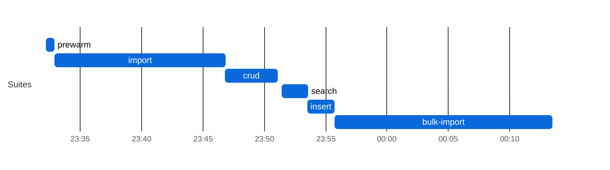

</details>

### Results

| Suite | Throughput | p50 ms | p95 ms | p99 ms | Err% | Checks ✓/✗ |
|-------|----:|-------:|-------:|-------:|-----:|-----------:|
| crud | 875 | 339.9 | 825.6 | 1042.0 | 0.0% | 216,000/0 |
| Batch/Transaction Import, `POST /` Bundles (resources/s; latency per Bundle) | 4,972 | 4188.9 | 13450.4 | 24764.3 | 0.2% | **996/4** |
| insert | 261 | 205.4 | 250.3 | 270.2 | 0.0% | 31,565/0 |
| prewarm | 97 | 90.0 | 304.3 | 388.9 | 0.0% | 3,240/0 |
| search | 1,081 | 24.3 | 60.6 | 92.2 | 0.0% | 130,176/0 |

<details><summary>Chart: mongodb-elasticsearch throughput and latency</summary>

**mongodb-elasticsearch: throughput per suite**

One bar per suite, higher is better; values in the table above (import is resources/s, the others requests/s); values span more than 50x, so read short bars in the table.

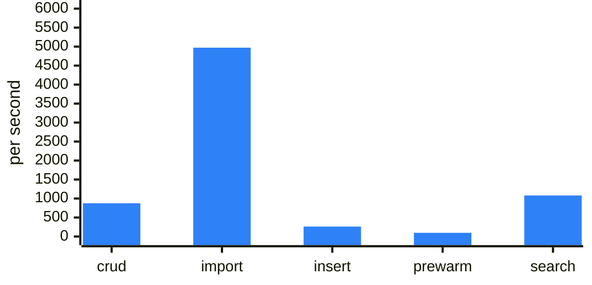

**mongodb-elasticsearch: latency per suite (ms)**

Overlaid bars per suite, light to dark blue: p99 (back), p95, p50 (front); lower is better; values in the table above (import, per Bundle, is left out).

```mermaid
%%{init: {"xyChart": {"width": 540, "height": 260, "useMaxWidth": false}, "themeVariables": {"xyChart": {"plotColorPalette": "#54aeff, #2f81f7, #0969da", "backgroundColor": "transparent"}}}}%%
xychart-beta
    x-axis ["crud", "insert", "prewarm", "search"]
    y-axis "ms" 0 --> 1200
    bar [1042, 270.2, 388.9, 92.2]
    bar [825.6, 250.3, 304.3, 60.6]
    bar [339.9, 205.4, 90, 24.3]
```

</details>

_Throughput is requests/s and latency is per request, except on the Batch/Transaction Import row (resources/s and per-Bundle latency, see the **Import** line above)._

---

## FHIR Benchmark — `main` (leg comparison)

Commit `e0bd5cb` · run 39657850695 · suites: all · 6 of 6 legs have results

### Throughput (requests/s unless the row names its unit)

| Suite | sqlite | postgres | mongodb | sqlite+ES | postgres+ES | mongodb+ES |
|---|---:|---:|---:|---:|---:|---:|
| prewarm | 1,475 | **1,867** | 1,232 | 90 | 102 | 97 |
| Batch/Transaction Import, `POST /` Bundles (resources/s) | 1,122 ‡ | 4,369 | 1,201 ‡ | 6,325 | 6,141 | 4,972 ‡ |
| Bulk Import, `$bulk-submit` (resources/s) | 1,122 | 1,042 | 620 | **3,057** | 2,565 | 1,638 |
| Bulk Import: ingest (resources/s, seconds) | 4,591 (355 s) | 3,196 (510 s) | 1,752 (930 s) | **7,409** (220 s) | 5,175 (315 s) | 2,527 (645 s) |
| Bulk Import: index rebuild (seconds) | 1,099 s | 1,054 s | 1,698 s | **313 s** | 321 s | 350 s |
| crud | 1,132 † | 2,175 | 1,539 † | 995 | 879 | 875 † |
| search | 4 † | 2,186 | 22 † | 920 | 869 | 1,081 † |
| insert (creates/s) | 827 | **1,425** | 1,167 | 267 | 263 | 261 |

<details><summary>Chart: throughput by leg, one chart per suite</summary>

**prewarm (requests/s)**

One bar per leg, largest first, longer is better; values in the table above, repeated in each label (with its † ‡ ⚠ markers).

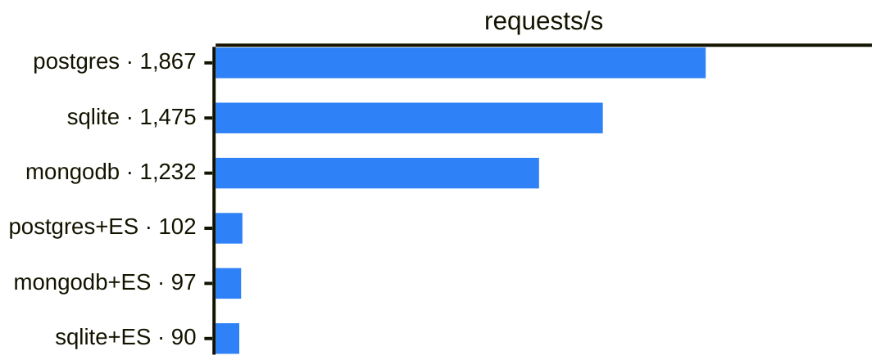

**Batch/Transaction Import (resources/s)**

One bar per leg, largest first, longer is better; values in the table above, repeated in each label (with its † ‡ ⚠ markers).

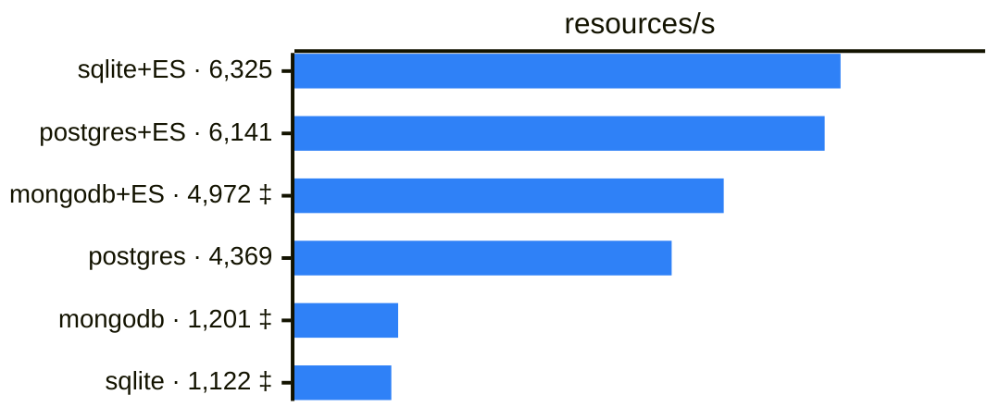

**Bulk Import (resources/s)**

One bar per leg, largest first, longer is better; values in the table above, repeated in each label (with its † ‡ ⚠ markers).

```mermaid
%%{init: {"xyChart": {"width": 540, "height": 220, "useMaxWidth": false, "yAxis": {"showLabel": false, "showTick": false}}, "themeVariables": {"xyChart": {"plotColorPalette": "#2f81f7", "backgroundColor": "transparent"}}}}%%
xychart-beta horizontal
    x-axis ["sqlite+ES · 3,057", "postgres+ES · 2,565", "mongodb+ES · 1,638", "sqlite · 1,122", "postgres · 1,042", "mongodb · 620"]
    y-axis "resources/s" 0 --> 4000
    bar [3057, 2565, 1638, 1122, 1042, 620]
```

**Bulk Import: ingest (resources/s, seconds)**

One bar per leg, largest first, longer is better; values in the table above, repeated in each label (with its † ‡ ⚠ markers).

```mermaid
%%{init: {"xyChart": {"width": 540, "height": 220, "useMaxWidth": false, "yAxis": {"showLabel": false, "showTick": false}}, "themeVariables": {"xyChart": {"plotColorPalette": "#2f81f7", "backgroundColor": "transparent"}}}}%%
xychart-beta horizontal
    x-axis ["sqlite+ES · 7,409 (220 s)", "postgres+ES · 5,175 (315 s)", "sqlite · 4,591 (355 s)", "postgres · 3,196 (510 s)", "mongodb+ES · 2,527 (645 s)", "mongodb · 1,752 (930 s)"]
    y-axis "resources/s" 0 --> 10000
    bar [7409, 5175, 4591, 3196, 2527, 1752]
```

**Bulk Import: index rebuild (seconds)**

One bar per leg, largest first, shorter is better; values in the table above, repeated in each label (with its † ‡ ⚠ markers).

```mermaid
%%{init: {"xyChart": {"width": 540, "height": 220, "useMaxWidth": false, "yAxis": {"showLabel": false, "showTick": false}}, "themeVariables": {"xyChart": {"plotColorPalette": "#2f81f7", "backgroundColor": "transparent"}}}}%%
xychart-beta horizontal
    x-axis ["mongodb · 1,698 s", "sqlite · 1,099 s", "postgres · 1,054 s", "mongodb+ES · 350 s", "postgres+ES · 321 s", "sqlite+ES · 313 s"]
    y-axis "seconds" 0 --> 2000
    bar [1698, 1099, 1054, 350, 321, 313]
```

**crud (requests/s)**

One bar per leg, largest first, longer is better; values in the table above, repeated in each label (with its † ‡ ⚠ markers).

```mermaid
%%{init: {"xyChart": {"width": 540, "height": 220, "useMaxWidth": false, "yAxis": {"showLabel": false, "showTick": false}}, "themeVariables": {"xyChart": {"plotColorPalette": "#2f81f7", "backgroundColor": "transparent"}}}}%%
xychart-beta horizontal
    x-axis ["postgres · 2,175", "mongodb · 1,539 †", "sqlite · 1,132 †", "sqlite+ES · 995", "postgres+ES · 879", "mongodb+ES · 875 †"]
    y-axis "requests/s" 0 --> 2500
    bar [2175, 1539, 1132, 995, 879, 875]
```

**search (requests/s)**

One bar per leg, largest first, longer is better; values in the table above, repeated in each label (with its † ‡ ⚠ markers). Values span 546x (no log axis in Mermaid): short bars are read from their label.

```mermaid
%%{init: {"xyChart": {"width": 540, "height": 220, "useMaxWidth": false, "yAxis": {"showLabel": false, "showTick": false}}, "themeVariables": {"xyChart": {"plotColorPalette": "#2f81f7", "backgroundColor": "transparent"}}}}%%
xychart-beta horizontal
    x-axis ["postgres · 2,186", "mongodb+ES · 1,081 †", "sqlite+ES · 920", "postgres+ES · 869", "mongodb · 22 †", "sqlite · 4 †"]
    y-axis "requests/s" 0 --> 2500
    bar [2186, 1081, 920, 869, 22, 4]
```

**insert (creates/s)**

One bar per leg, largest first, longer is better; values in the table above, repeated in each label (with its † ‡ ⚠ markers).

```mermaid
%%{init: {"xyChart": {"width": 540, "height": 220, "useMaxWidth": false, "yAxis": {"showLabel": false, "showTick": false}}, "themeVariables": {"xyChart": {"plotColorPalette": "#2f81f7", "backgroundColor": "transparent"}}}}%%
xychart-beta horizontal
    x-axis ["postgres · 1,425", "mongodb · 1,167", "sqlite · 827", "sqlite+ES · 267", "postgres+ES · 263", "mongodb+ES · 261"]
    y-axis "creates/s" 0 --> 2000
    bar [1425, 1167, 827, 267, 263, 261]
```

</details>

### p95 latency (ms)

| Suite | sqlite | postgres | mongodb | sqlite+ES | postgres+ES | mongodb+ES |
|---|---:|---:|---:|---:|---:|---:|
| prewarm | 20.6 | **11.6** | 19.9 | 292.3 | 287.7 | 304.3 |
| Batch/Transaction Import, `POST /` Bundles (per Bundle) | 60259.9 ‡ | 26629.8 | 49344.2 ‡ | 10268.1 | 10958.2 | 13450.4 ‡ |
| Bulk Import, `$bulk-submit` | n/a (one async job) | n/a (one async job) | n/a (one async job) | n/a (one async job) | n/a (one async job) | n/a (one async job) |
| crud | 902.2 † | 290.0 | 380.0 † | 749.2 | 798.6 | 825.6 † |
| search | 17373.9 † | 40.4 | 9387.3 † | 68.9 | 73.0 | 60.6 † |
| insert | 113.3 | **57.7** | 71.0 | 243.6 | 247.1 | 250.3 |

<details><summary>Chart: p95 latency by leg, one chart per suite</summary>

**prewarm p95 (ms)**

One bar per leg, largest first, shorter is better; values in the table above, repeated in each label (with its † ‡ ⚠ markers).

```mermaid
%%{init: {"xyChart": {"width": 540, "height": 220, "useMaxWidth": false, "yAxis": {"showLabel": false, "showTick": false}}, "themeVariables": {"xyChart": {"plotColorPalette": "#2f81f7", "backgroundColor": "transparent"}}}}%%
xychart-beta horizontal
    x-axis ["mongodb+ES · 304.3", "sqlite+ES · 292.3", "postgres+ES · 287.7", "sqlite · 20.6", "mongodb · 19.9", "postgres · 11.6"]
    y-axis "ms" 0 --> 400
    bar [304.3, 292.3, 287.7, 20.6, 19.9, 11.6]
```

**Batch/Transaction Import p95 (ms)**

One bar per leg, largest first, shorter is better; values in the table above, repeated in each label (with its † ‡ ⚠ markers).

```mermaid
%%{init: {"xyChart": {"width": 540, "height": 220, "useMaxWidth": false, "yAxis": {"showLabel": false, "showTick": false}}, "themeVariables": {"xyChart": {"plotColorPalette": "#2f81f7", "backgroundColor": "transparent"}}}}%%
xychart-beta horizontal
    x-axis ["sqlite · 60259.9 ‡", "mongodb · 49344.2 ‡", "postgres · 26629.8", "mongodb+ES · 13450.4 ‡", "postgres+ES · 10958.2", "sqlite+ES · 10268.1"]
    y-axis "ms" 0 --> 80000
    bar [60259.9, 49344.2, 26629.8, 13450.4, 10958.2, 10268.1]
```

**crud p95 (ms)**

One bar per leg, largest first, shorter is better; values in the table above, repeated in each label (with its † ‡ ⚠ markers).

```mermaid
%%{init: {"xyChart": {"width": 540, "height": 220, "useMaxWidth": false, "yAxis": {"showLabel": false, "showTick": false}}, "themeVariables": {"xyChart": {"plotColorPalette": "#2f81f7", "backgroundColor": "transparent"}}}}%%
xychart-beta horizontal
    x-axis ["sqlite · 902.2 †", "mongodb+ES · 825.6 †", "postgres+ES · 798.6", "sqlite+ES · 749.2", "mongodb · 380.0 †", "postgres · 290.0"]
    y-axis "ms" 0 --> 1000
    bar [902.2, 825.6, 798.6, 749.2, 380, 290]
```

**search p95 (ms)**

One bar per leg, largest first, shorter is better; values in the table above, repeated in each label (with its † ‡ ⚠ markers). Values span 430x (no log axis in Mermaid): short bars are read from their label.

```mermaid
%%{init: {"xyChart": {"width": 540, "height": 220, "useMaxWidth": false, "yAxis": {"showLabel": false, "showTick": false}}, "themeVariables": {"xyChart": {"plotColorPalette": "#2f81f7", "backgroundColor": "transparent"}}}}%%
xychart-beta horizontal
    x-axis ["sqlite · 17373.9 †", "mongodb · 9387.3 †", "postgres+ES · 73.0", "sqlite+ES · 68.9", "mongodb+ES · 60.6 †", "postgres · 40.4"]
    y-axis "ms" 0 --> 20000
    bar [17373.9, 9387.3, 73, 68.9, 60.6, 40.4]
```

**insert p95 (ms)**

One bar per leg, largest first, shorter is better; values in the table above, repeated in each label (with its † ‡ ⚠ markers).

```mermaid
%%{init: {"xyChart": {"width": 540, "height": 220, "useMaxWidth": false, "yAxis": {"showLabel": false, "showTick": false}}, "themeVariables": {"xyChart": {"plotColorPalette": "#2f81f7", "backgroundColor": "transparent"}}}}%%
xychart-beta horizontal
    x-axis ["mongodb+ES · 250.3", "postgres+ES · 247.1", "sqlite+ES · 243.6", "sqlite · 113.3", "mongodb · 71.0", "postgres · 57.7"]
    y-axis "ms" 0 --> 300
    bar [250.3, 247.1, 243.6, 113.3, 71, 57.7]
```

</details>

### Errors (Err% · failed checks)

| Suite | sqlite | postgres | mongodb | sqlite+ES | postgres+ES | mongodb+ES |
|---|---:|---:|---:|---:|---:|---:|
| prewarm | 0.0% | 0.0% | 0.0% | 0.0% | 0.0% | 0.0% |
| Batch/Transaction Import, `POST /` Bundles | **3.9%** · **78 ✗** | 0.0% | 0.5% · **11 ✗** | 0.0% | 0.0% | 0.2% · **4 ✗** |
| Bulk Import, `$bulk-submit` | 0.0% | 0.0% | 0.0% | 0.0% | 0.0% | 0.0% |
| crud | 0.0% | 0.0% | 0.0% | 0.0% | 0.0% | 0.0% |
| search | 0.0% | 0.0% | 0.0% | 0.0% | 0.0% | 0.0% |
| insert | 0.0% | 0.0% | 0.0% | 0.0% | 0.0% | 0.0% |

`†` crud/search/reindex ran on an incomplete corpus (import below 1000/1000 bundles or not run before it, or the ES index not drained); on Bulk Import and its index rebuild, search did not return every resource it ingested · `‡` more than 1% errors or failed checks in that suite (on Bulk Import and its ingest, any resource not ingested; on its initial index, a rebuild that did not complete or reported errors; on reindex, any reindex error or a failed job) · `⚠` contended host (postgres crud above 3 ms/call) or a backend container died · **bold** = best in its row, shown only when no leg in that row carries a marker or `(partial)` (on the Bulk Import ingest and index rebuild rows, also only when every leg indexed the same way) · Bulk Import is resources/s through `$bulk-submit` into a fresh database, kick-off until the search index covers it, and its ingest and initial index rows split that time (see the note below the tables); reindex is resources/s of one `$reindex` of the type its row names, in the corpus import loaded, `(partial)` when it did not finish (the reason is in that leg's job summary); each is one asynchronous job, so its p95 is n/a · n/a = no result (reason in brackets)

Batch/Transaction Import row (suite `import`): **resources/s** = entries of the transaction Bundles that committed (k6 `bundle_size`) per second of the import scenario's own clock, which starts after k6 setup() has loaded the two seed Bundles (that time is in Leg health) — the unit upstream's report uses. Its p95 is **per Bundle**: one k6 iteration, the corpus fetch plus the transaction POST. k6's `http_reqs` is not used for import: it counts a corpus GET beside every Bundle POST. Bundles/s is in Leg health. Its resources/s is not comparable with the Bulk Import row's: committed Bundle entries per second of the k6 scenario, against resources until the search index covers them.

Bulk Import ingest and index rebuild rows: the same `$bulk-submit` load as the Bulk Import row, split into the two times a user waits for. **Ingest** = resources ingested ÷ seconds from kick-off until the status manifest is final, those seconds in brackets: how long loading the corpus takes. **Index rebuild** = seconds from then until HFS's deferred search-index rebuild of that freshly loaded data has finished (HFS_BULK_SUBMIT_DEFER_INDEXING, the default); the Search check in the Bulk import table then confirms it is searchable. `inline (during ingest)` = the backend indexed each batch while ingesting (DEFER_INDEXING=false), so its indexing time is inside its ingest seconds — it is not a zero-second index; `+ N s rebuild` is a follow-up rebuild of the types the index rejected. No best is marked on either row when legs indexed differently. Both rows are in the Throughput table only (one asynchronous job: no p95; failed resources are in the Bulk Import Errors row).

### Leg health

| Leg | Results | Runner | Import | Result sizes | ES drain | Host at crud start |
|---|---|---|---|---|---|---|
| `sqlite` | ✓ | github-agent2 · 8 CPU / 23G | 922/1000 · 1,527,543 entries in 1,361 s + 5 s setup · 0.68 Bundles/s † | Patient 922 · Observation 657,369 | — | load 5.75 · 17 containers |
| `postgres` | ✓ | github-agent6 · 8 CPU / 23G | 1,000/1000 · 1,627,336 entries in 372 s + 20 s setup · 2.68 Bundles/s | Patient 1,000 · Observation 689,080 | — | load 11.99 · 33 containers · pg 0.19 ms/call |
| `mongodb` | ✓ | github-agent3 · 8 CPU / 23G | 989/1000 · 1,312,554 entries in 1,093 s + 22 s setup · 0.90 Bundles/s † | Patient 989 · Observation 564,051 | — | load 5.51 · 53 containers |
| `sqlite-elasticsearch` | ✓ | github-agent1 · 8 CPU / 23G | 1,000/1000 · 1,627,336 entries in 257 s + 427 s setup · 3.89 Bundles/s | Patient 1,000 · Observation 689,080 | drained · 0 missing | load 6.81 · 22 containers |
| `postgres-elasticsearch` | ✓ | github-agent2 · 8 CPU / 23G | 1,000/1000 · 1,627,336 entries in 265 s + 520 s setup · 3.77 Bundles/s | Patient 1,000 · Observation 689,080 | drained · 0 missing | load 8.85 · 23 containers |
| `mongodb-elasticsearch` | ✓ | github-agent7 · 8 CPU / 23G | 996/1000 · 1,465,188 entries in 295 s + 531 s setup · 3.38 Bundles/s † | Patient 996 · Observation 626,637 | drained · 0 missing | load 3.86 · 23 containers |

### Bulk import (`$bulk-submit`)

Each leg loaded the corpus `import` loads (its 2 seed bundles and 1,000 bundles, converted to per-resource-type NDJSON) through `$bulk-submit`, in a fresh database served by a second HFS, after the search suite. **Ingest** is kick-off until the status manifest is final; **Index** is the deferred search-index rebuild that follows (followed in the second HFS's log); **Total** is both, and is what the Bulk Import row above divides the ingested resources by; the ingest and index rebuild rows above show **Ingest** and **Index** on their own. **Index** reads `inline (during ingest)` when HFS indexed while ingesting, so that time is inside **Ingest**. **Search check** compares Patient and Observation totals and two indexed queries with the converted corpus. It counts the 3,349 seed resources the Batch/Transaction Import row's entries do not.

| Leg | Result | Resources ingested | Ingest | Index | Total | Search check |
|---|---|---:|---:|---:|---:|---|
| `sqlite` | ✓ | 1,630,685/1,630,685 | 355 s · 4,591/s | 1,099 s | 1,454 s | ✓ Patient 1,000 · Observation 689,080 |
| `postgres` | ✓ | 1,630,685/1,630,685 | 510 s · 3,196/s | 1,054 s | 1,564 s | ✓ Patient 1,000 · Observation 689,080 |
| `mongodb` | ✓ | 1,630,685/1,630,685 | 930 s · 1,752/s | 1,698 s | 2,628 s | ✓ Patient 1,000 · Observation 689,080 |
| `sqlite-elasticsearch` | ✓ | 1,630,685/1,630,685 | 220 s · 7,409/s | 313 s | 533 s | ✓ Patient 1,000 · Observation 689,080 |
| `postgres-elasticsearch` | ✓ | 1,630,685/1,630,685 | 315 s · 5,175/s | 321 s | 636 s | ✓ Patient 1,000 · Observation 689,080 |
| `mongodb-elasticsearch` | ✓ | 1,630,685/1,630,685 | 645 s · 2,527/s | 350 s | 996 s | ✓ Patient 1,000 · Observation 689,080 |

<details><summary>Chart: Bulk Import phases by leg</summary>

**Bulk Import: ingest then index rebuild**

Per leg, ingest (dark) then the deferred index rebuild (light), on elapsed h:mm since kick-off; shorter is better; values in the table above.

```mermaid
%%{init: {"gantt": {"useMaxWidth": false, "barHeight": 16, "barGap": 4, "fontSize": 11, "sectionFontSize": 11, "leftPadding": 150}, "themeVariables": {"taskBkgColor": "#0969da", "taskBorderColor": "#0969da", "taskTextColor": "#ffffff", "taskTextLightColor": "#ffffff", "doneTaskBkgColor": "#54aeff", "doneTaskBorderColor": "#54aeff", "taskTextDarkColor": "#1f2328", "gridColor": "#8c959f", "sectionBkgColor": "transparent", "altSectionBkgColor": "transparent", "sectionBkgColor2": "transparent"}, "themeCSS": ".grid .tick line{stroke:#8c959f;stroke-opacity:.6}"}}%%
gantt
    dateFormat YYYY-MM-DD HH:mm:ss
    axisFormat %H:%M
    todayMarker off
    section sqlite
    ingest 355 s :i0, 2000-01-01 00:00:00, 2000-01-01 00:05:55
    index 1,099 s :done, x0, after i0, 1099s
    section postgres
    ingest 510 s :i1, 2000-01-01 00:00:00, 2000-01-01 00:08:30
    index 1,054 s :done, x1, after i1, 1054s
    section mongodb
    ingest 930 s :i2, 2000-01-01 00:00:00, 2000-01-01 00:15:30
    index 1,698 s :done, x2, after i2, 1698s
    section sqlite-elasticsearch
    ingest 220 s :i3, 2000-01-01 00:00:00, 2000-01-01 00:03:40
    index 313 s :done, x3, after i3, 313s
    section postgres-elasticsearch
    ingest 315 s :i4, 2000-01-01 00:00:00, 2000-01-01 00:05:15
    index 321 s :done, x4, after i4, 321s
    section mongodb-elasticsearch
    ingest 645 s :i5, 2000-01-01 00:00:00, 2000-01-01 00:10:45
    index 350 s :done, x5, after i5, 350s
```

</details>

Runners: github-agent1, github-agent2, github-agent3, github-agent6, github-agent7 (8 CPU / 23G each).

Result sizes differ across legs (Observation 564,051 – 689,080), so crud and search did not run on the same corpus.

`insert` is HFS's own suite (`.github/scripts/fhir-bench/k6/insert.js`, load shape in its header): single-resource `POST Patient` and `POST Observation` creates, each Observation referencing that Patient, so every request is one create and its throughput row is creates/s. It runs last, after search and after the result-size snapshot, so its resources are in neither, and it never carries `†` because it does not read the corpus.

_Per-leg detail (leg configuration, p50/p99 and checks, the result-size cross-check, search latency by query shape) is in each `Benchmark (<leg>)` job summary; raw files are in the `fhir-benchmark-<leg>-<run id>` artifacts._
