## FHIR Benchmark — `main` (leg comparison)

Commit `e0bd5cb` · run 39657850695 · suites: all · 6 of 6 legs have results

### Throughput (requests/s unless the row names its unit)

| Suite | sqlite | postgres | mongodb | sqlite+ES | postgres+ES | mongodb+ES |
|---|---:|---:|---:|---:|---:|---:|
| prewarm | 1,475 | **1,867** | 1,232 | 90 | 102 | 97 |
| Batch/Transaction Import, `POST /` Bundles (resources/s) | 1,122 ‡ | 4,369 | 1,201 ‡ | 6,325 | 6,141 | 4,972 ‡ |
| Bulk Import, `$bulk-submit` (resources/s) | 1,122 | 1,042 | 620 | **3,057** | 2,565 | 1,638 |
| Bulk Import: ingest (resources/s, seconds) | 4,591 (355 s) | 3,196 (510 s) | 1,752 (930 s) | **7,409** (220 s) | 5,175 (315 s) | 2,527 (645 s) |
| Bulk Import: index rebuild (seconds) | 1,099 s | 1,054 s | 1,698 s | **313 s** | 321 s | 350 s |
| crud | 1,132 † | 2,175 | 1,539 † | 995 | 879 | 875 † |
| search | 4 † | 2,186 | 22 † | 920 | 869 | 1,081 † |
| insert (creates/s) | 827 | **1,425** | 1,167 | 267 | 263 | 261 |

### p95 latency (ms)

| Suite | sqlite | postgres | mongodb | sqlite+ES | postgres+ES | mongodb+ES |
|---|---:|---:|---:|---:|---:|---:|
| prewarm | 20.6 | **11.6** | 19.9 | 292.3 | 287.7 | 304.3 |
| Batch/Transaction Import, `POST /` Bundles (per Bundle) | 60259.9 ‡ | 26629.8 | 49344.2 ‡ | 10268.1 | 10958.2 | 13450.4 ‡ |
| Bulk Import, `$bulk-submit` | n/a (one async job) | n/a (one async job) | n/a (one async job) | n/a (one async job) | n/a (one async job) | n/a (one async job) |
| crud | 902.2 † | 290.0 | 380.0 † | 749.2 | 798.6 | 825.6 † |
| search | 17373.9 † | 40.4 | 9387.3 † | 68.9 | 73.0 | 60.6 † |
| insert | 113.3 | **57.7** | 71.0 | 243.6 | 247.1 | 250.3 |

### Errors (Err% · failed checks)

| Suite | sqlite | postgres | mongodb | sqlite+ES | postgres+ES | mongodb+ES |
|---|---:|---:|---:|---:|---:|---:|
| prewarm | 0.0% | 0.0% | 0.0% | 0.0% | 0.0% | 0.0% |
| Batch/Transaction Import, `POST /` Bundles | **3.9%** · **78 ✗** | 0.0% | 0.5% · **11 ✗** | 0.0% | 0.0% | 0.2% · **4 ✗** |
| Bulk Import, `$bulk-submit` | 0.0% | 0.0% | 0.0% | 0.0% | 0.0% | 0.0% |
| crud | 0.0% | 0.0% | 0.0% | 0.0% | 0.0% | 0.0% |
| search | 0.0% | 0.0% | 0.0% | 0.0% | 0.0% | 0.0% |
| insert | 0.0% | 0.0% | 0.0% | 0.0% | 0.0% | 0.0% |

`†` crud/search/reindex ran on an incomplete corpus (import below 1000/1000 bundles or not run before it, or the ES index not drained); on Bulk Import and its index rebuild, search did not return every resource it ingested · `‡` more than 1% errors or failed checks in that suite (on Bulk Import and its ingest, any resource not ingested; on its initial index, a rebuild that did not complete or reported errors; on reindex, any reindex error or a failed job) · `⚠` contended host (postgres crud above 3 ms/call) or a backend container died · **bold** = best in its row, shown only when no leg in that row carries a marker or `(partial)` (on the Bulk Import ingest and index rebuild rows, also only when every leg indexed the same way) · Bulk Import is resources/s through `$bulk-submit` into a fresh database, kick-off until the search index covers it, and its ingest and initial index rows split that time (see the note below the tables); reindex is resources/s of one `$reindex` of the type its row names, in the corpus import loaded, `(partial)` when it did not finish (the reason is in that leg's job summary); each is one asynchronous job, so its p95 is n/a · n/a = no result (reason in brackets)

Batch/Transaction Import row (suite `import`): **resources/s** = entries of the transaction Bundles that committed (k6 `bundle_size`) per second of the import scenario's own clock, which starts after k6 setup() has loaded the two seed Bundles (that time is in Leg health) — the unit upstream's report uses. Its p95 is **per Bundle**: one k6 iteration, the corpus fetch plus the transaction POST. k6's `http_reqs` is not used for import: it counts a corpus GET beside every Bundle POST. Bundles/s is in Leg health. Its resources/s is not comparable with the Bulk Import row's: committed Bundle entries per second of the k6 scenario, against resources until the search index covers them.

Bulk Import ingest and index rebuild rows: the same `$bulk-submit` load as the Bulk Import row, split into the two times a user waits for. **Ingest** = resources ingested ÷ seconds from kick-off until the status manifest is final, those seconds in brackets: how long loading the corpus takes. **Index rebuild** = seconds from then until HFS's deferred search-index rebuild of that freshly loaded data has finished (HFS_BULK_SUBMIT_DEFER_INDEXING, the default); the Search check in the Bulk import table then confirms it is searchable. `inline (during ingest)` = the backend indexed each batch while ingesting (DEFER_INDEXING=false), so its indexing time is inside its ingest seconds — it is not a zero-second index; `+ N s rebuild` is a follow-up rebuild of the types the index rejected. No best is marked on either row when legs indexed differently. Both rows are in the Throughput table only (one asynchronous job: no p95; failed resources are in the Bulk Import Errors row).

### Leg health

| Leg | Results | Runner | Import | Result sizes | ES drain | Host at crud start |
|---|---|---|---|---|---|---|
| `sqlite` | ✓ | github-agent2 · 8 CPU / 23G | 922/1000 · 1,527,543 entries in 1,361 s + 5 s setup · 0.68 Bundles/s † | Patient 922 · Observation 657,369 | — | load 5.75 · 17 containers |
| `postgres` | ✓ | github-agent6 · 8 CPU / 23G | 1,000/1000 · 1,627,336 entries in 372 s + 20 s setup · 2.68 Bundles/s | Patient 1,000 · Observation 689,080 | — | load 11.99 · 33 containers · pg 0.19 ms/call |
| `mongodb` | ✓ | github-agent3 · 8 CPU / 23G | 989/1000 · 1,312,554 entries in 1,093 s + 22 s setup · 0.90 Bundles/s † | Patient 989 · Observation 564,051 | — | load 5.51 · 53 containers |
| `sqlite-elasticsearch` | ✓ | github-agent1 · 8 CPU / 23G | 1,000/1000 · 1,627,336 entries in 257 s + 427 s setup · 3.89 Bundles/s | Patient 1,000 · Observation 689,080 | drained · 0 missing | load 6.81 · 22 containers |
| `postgres-elasticsearch` | ✓ | github-agent2 · 8 CPU / 23G | 1,000/1000 · 1,627,336 entries in 265 s + 520 s setup · 3.77 Bundles/s | Patient 1,000 · Observation 689,080 | drained · 0 missing | load 8.85 · 23 containers |
| `mongodb-elasticsearch` | ✓ | github-agent7 · 8 CPU / 23G | 996/1000 · 1,465,188 entries in 295 s + 531 s setup · 3.38 Bundles/s † | Patient 996 · Observation 626,637 | drained · 0 missing | load 3.86 · 23 containers |

### Bulk import (`$bulk-submit`)

Each leg loaded the corpus `import` loads (its 2 seed bundles and 1,000 bundles, converted to per-resource-type NDJSON) through `$bulk-submit`, in a fresh database served by a second HFS, after the search suite. **Ingest** is kick-off until the status manifest is final; **Index** is the deferred search-index rebuild that follows (followed in the second HFS's log); **Total** is both, and is what the Bulk Import row above divides the ingested resources by; the ingest and index rebuild rows above show **Ingest** and **Index** on their own. **Index** reads `inline (during ingest)` when HFS indexed while ingesting, so that time is inside **Ingest**. **Search check** compares Patient and Observation totals and two indexed queries with the converted corpus. It counts the 3,349 seed resources the Batch/Transaction Import row's entries do not.

| Leg | Result | Resources ingested | Ingest | Index | Total | Search check |
|---|---|---:|---:|---:|---:|---|
| `sqlite` | ✓ | 1,630,685/1,630,685 | 355 s · 4,591/s | 1,099 s | 1,454 s | ✓ Patient 1,000 · Observation 689,080 |
| `postgres` | ✓ | 1,630,685/1,630,685 | 510 s · 3,196/s | 1,054 s | 1,564 s | ✓ Patient 1,000 · Observation 689,080 |
| `mongodb` | ✓ | 1,630,685/1,630,685 | 930 s · 1,752/s | 1,698 s | 2,628 s | ✓ Patient 1,000 · Observation 689,080 |
| `sqlite-elasticsearch` | ✓ | 1,630,685/1,630,685 | 220 s · 7,409/s | 313 s | 533 s | ✓ Patient 1,000 · Observation 689,080 |
| `postgres-elasticsearch` | ✓ | 1,630,685/1,630,685 | 315 s · 5,175/s | 321 s | 636 s | ✓ Patient 1,000 · Observation 689,080 |
| `mongodb-elasticsearch` | ✓ | 1,630,685/1,630,685 | 645 s · 2,527/s | 350 s | 996 s | ✓ Patient 1,000 · Observation 689,080 |

Runners: github-agent1, github-agent2, github-agent3, github-agent6, github-agent7 (8 CPU / 23G each).

Result sizes differ across legs (Observation 564,051 – 689,080), so crud and search did not run on the same corpus.

`insert` is HFS's own suite (`.github/scripts/fhir-bench/k6/insert.js`, load shape in its header): single-resource `POST Patient` and `POST Observation` creates, each Observation referencing that Patient, so every request is one create and its throughput row is creates/s. It runs last, after search and after the result-size snapshot, so its resources are in neither, and it never carries `†` because it does not read the corpus.

_Per-leg detail (leg configuration, p50/p99 and checks, the result-size cross-check, search latency by query shape) is in each `Benchmark (<leg>)` job summary; raw files are in the `fhir-benchmark-<leg>-<run id>` artifacts._

### Charts

Chart: throughput by leg, one chart per suite

**prewarm (requests/s)**

One bar per leg, largest first, longer is better; values in the Throughput table above, repeated in each label (with its † ‡ ⚠ markers).

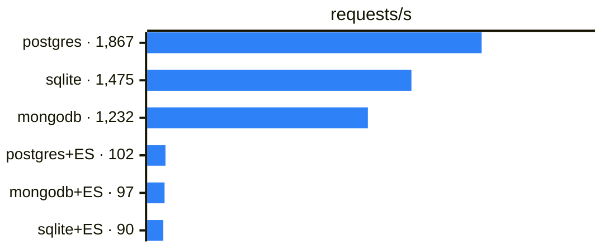

**Batch/Transaction Import (resources/s)**

One bar per leg, largest first, longer is better; values in the Throughput table above, repeated in each label (with its † ‡ ⚠ markers).

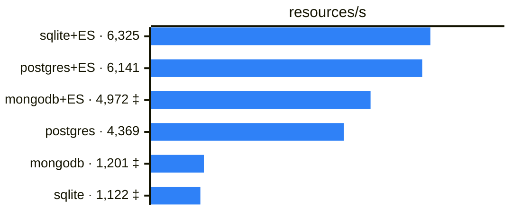

**Bulk Import (resources/s)**

One bar per leg, largest first, longer is better; values in the Throughput table above, repeated in each label (with its † ‡ ⚠ markers).

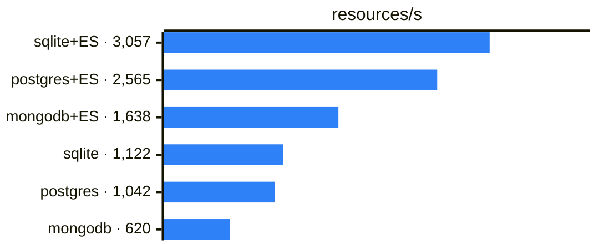

**Bulk Import: ingest (resources/s, seconds)**

One bar per leg, largest first, longer is better; values in the Throughput table above, repeated in each label (with its † ‡ ⚠ markers).

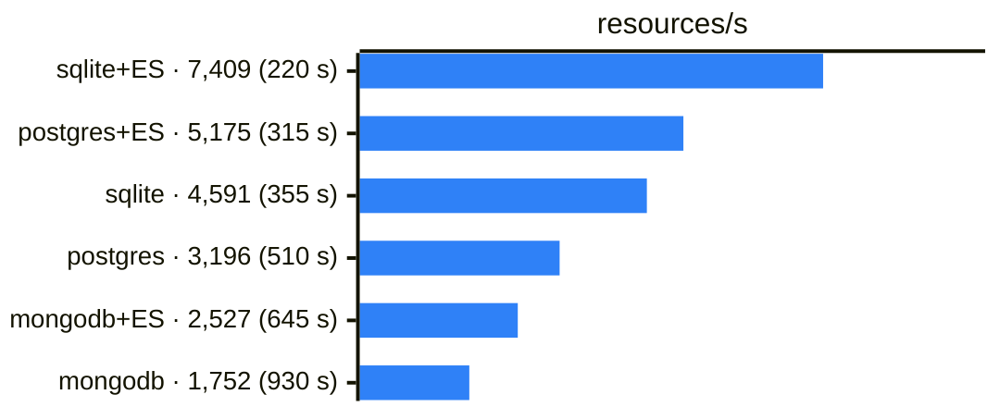

**Bulk Import: index rebuild (seconds)**

One bar per leg, largest first, shorter is better; values in the Throughput table above, repeated in each label (with its † ‡ ⚠ markers).

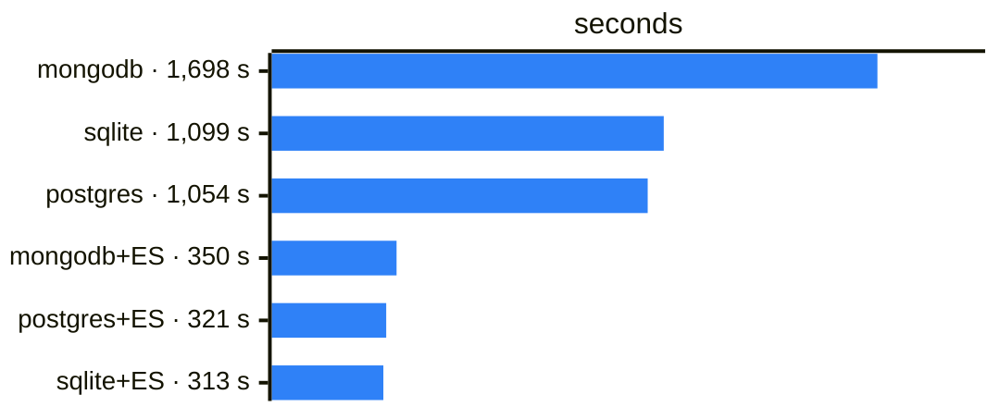

**crud (requests/s)**

One bar per leg, largest first, longer is better; values in the Throughput table above, repeated in each label (with its † ‡ ⚠ markers).

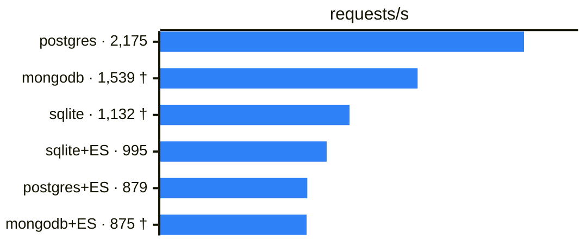

**search (requests/s)**

One bar per leg, largest first, longer is better; values in the Throughput table above, repeated in each label (with its † ‡ ⚠ markers). Values span 546x (no log axis in Mermaid): short bars are read from their label.

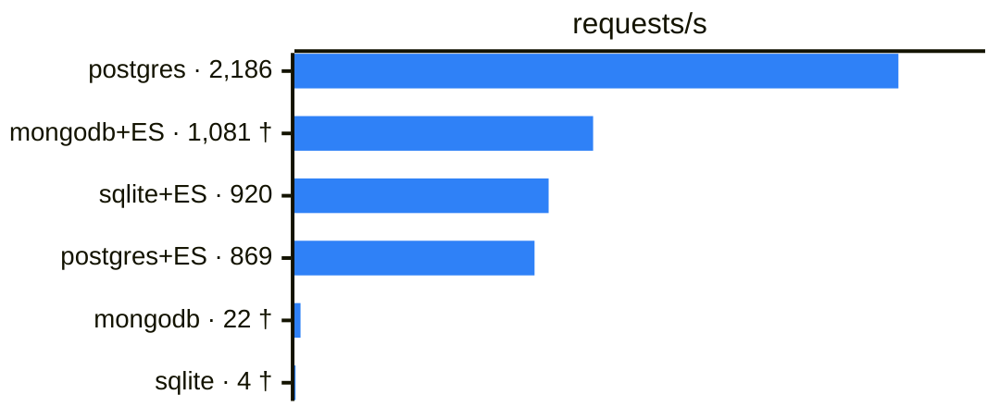

**insert (creates/s)**

One bar per leg, largest first, longer is better; values in the Throughput table above, repeated in each label (with its † ‡ ⚠ markers).

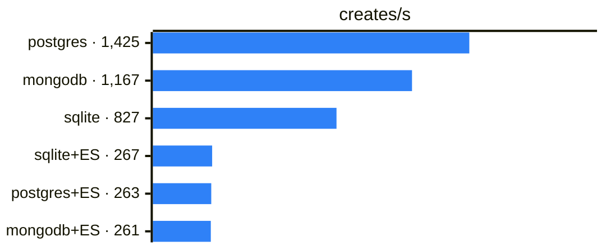

Chart: p95 latency by leg, one chart per suite

**prewarm p95 (ms)**

One bar per leg, largest first, shorter is better; values in the p95 latency table above, repeated in each label (with its † ‡ ⚠ markers).

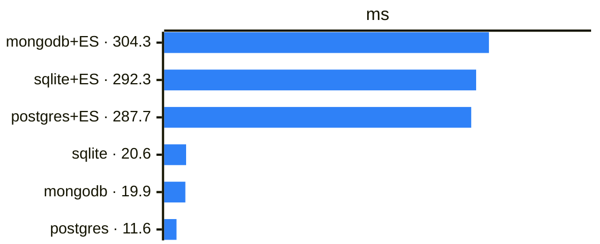

**Batch/Transaction Import p95 (ms)**

One bar per leg, largest first, shorter is better; values in the p95 latency table above, repeated in each label (with its † ‡ ⚠ markers).

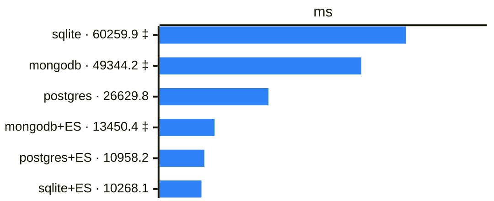

**crud p95 (ms)**

One bar per leg, largest first, shorter is better; values in the p95 latency table above, repeated in each label (with its † ‡ ⚠ markers).

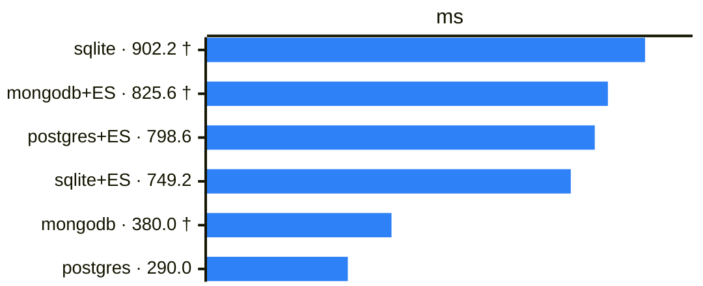

**search p95 (ms)**

One bar per leg, largest first, shorter is better; values in the p95 latency table above, repeated in each label (with its † ‡ ⚠ markers). Values span 430x (no log axis in Mermaid): short bars are read from their label.

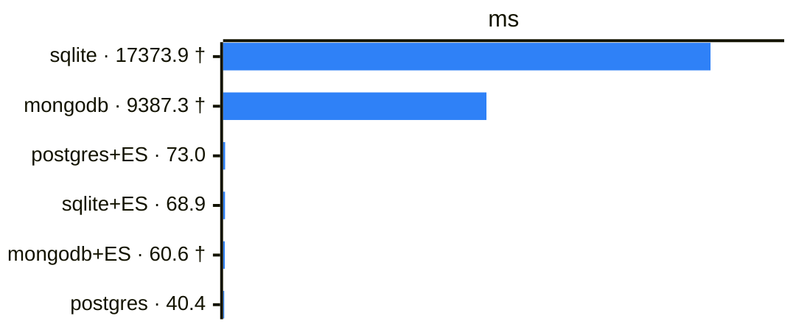

**insert p95 (ms)**

One bar per leg, largest first, shorter is better; values in the p95 latency table above, repeated in each label (with its † ‡ ⚠ markers).

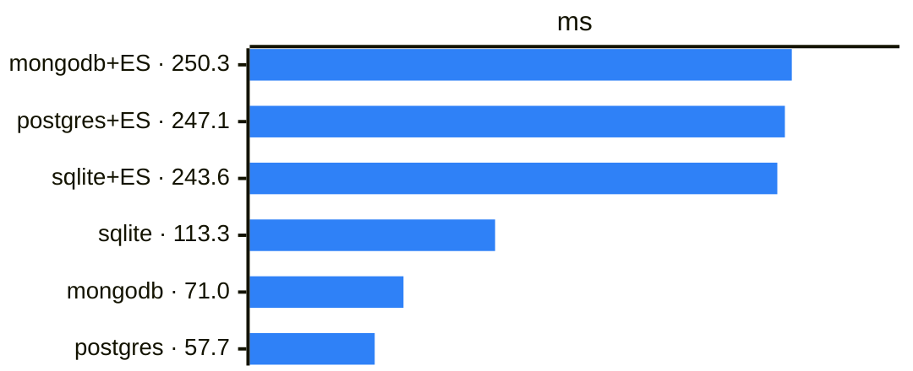

Chart: Bulk Import phases by leg

**Bulk Import: ingest then index rebuild**

Per leg, ingest (dark) then the deferred index rebuild (light), on elapsed h:mm since kick-off; shorter is better; values in the Bulk import table above.

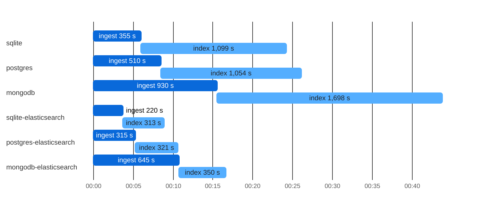

