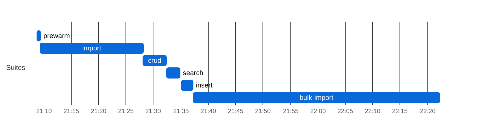
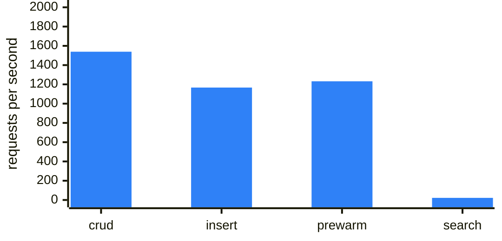
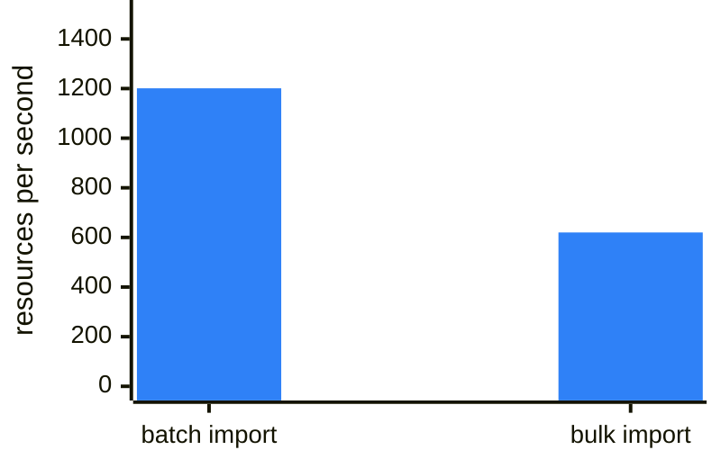

### MongoDB tuning (mongodb)

| setting | value |
|---|---|
| image | `mongo:7.0` — single-member replica set `rs0`, directConnection |
| --wiredTigerCacheSizeGB | `2` (mongod reports @@WT_MAX_BYTES@@ bytes) |
| transactionLifetimeLimitSeconds | `@@TXN_LIFETIME@@` |
| --oplogSize | `2048MB` |
| HFS_MONGODB_MAX_CONNECTIONS | `32` |
| HFS_MONGODB_DATABASE | `hfs_bench` |
| data volume free space (start) | `171437 MB` |
### Search latency by query shape (mongodb)
| Query shape | n | median (ms) | p95 (ms) | max (ms) |
|---|---:|---:|---:|---:|
| `composite Observation?code-value-quantity` | 127 | 9284 | 15432 | 16586 |
| `composite Observation?component-code-value-quantity` | 127 | 8972 | 13584 | 15367 |
| `composite Observation?combo-code-value-quantity` | 127 | 8644 | 11794 | 13306 |
| `date Observation?date` | 127 | 151 | 3498 | 7894 |
| `quantity Observation?component-value-quantity` | 127 | 530 | 950 | 1743 |
| `quantity Observation?value-quantity` | 127 | 175 | 789 | 966 |
| `quantity Observation?combo-value-quantity` | 127 | 152 | 716 | 1309 |
| `token Observation?code` | 127 | 406 | 700 | 1039 |
| `token Observation?category` | 127 | 137 | 699 | 870 |
| `token Encounter?class` | 127 | 155 | 510 | 684 |
| `date Encounter?date` | 127 | 124 | 491 | 14118 |
| `string Patient?address` | 127 | 254 | 485 | 900 |
| `reference MedicationRequest?requester` | 127 | 100 | 393 | 503 |
| `reference Encounter?participant` | 127 | 118 | 391 | 642 |
| `date Patient?birthdate` | 127 | 123 | 364 | 678 |
| `string Patient?name` | 127 | 135 | 341 | 539 |
| `reference Observation?subject` | 127 | 122 | 244 | 429 |
| `token Encounter?status` | 127 | 95 | 236 | 322 |
| `string Organization?name` | 127 | 64 | 216 | 774 |
| `reference Observation?performer` | 127 | 76 | 196 | 243 |
| `reference Encounter?subject` | 127 | 73 | 194 | 265 |
| `reference Observation?encounter` | 127 | 61 | 179 | 117916 |
| `reference MedicationRequest?subject` | 127 | 81 | 170 | 285 |
| `reference MedicationRequest?encounter` | 127 | 59 | 168 | 285 |
| `? ??http://localhost:8083/Patient?_count=20&_elements=id` | 1 | 10 | 10 | 10 |
| `? ??http://localhost:8083/Encounter?_count=20&_elements=id` | 1 | 4 | 4 | 4 |
| `? ??http://localhost:8083/Practitioner?_count=20&_elements=id` | 1 | 2 | 2 | 2 |
## FHIR Benchmark — `main` (mongodb)

| | |
|---|---|
| **Commit**  | `e0bd5cb` |
| **Backend** | `mongodb` |
| **Suites**  | all |

### Leg configuration

| | |
|---|---|
| **Backend** | `mongodb` |
| **Mongo WT cache** | `2` GB |
| **Mongo pool max** | `32` |
| **Legs at once (max_parallel)** | 1 |
| **Leg timeout** | 150 min |
| **Capacity gate** | need 3072 MB, available 10923 MB (source `docker-stats`), waited 2 s |

**Batch/Transaction Import** (`POST /` Bundles): 989/1000 bundles, 1,312,554 entries in 1115 s — **1,201 resources/s** (0.90 Bundles/s) over the 1,093 s import scenario, after 22 s of k6 setup() (the two seed Bundles). ⚠ **Batch/Transaction Import incomplete — crud/search on this leg ran on a smaller corpus and are not comparable to a 1000/1000 leg** (and abandoned Batch/Transaction Import requests may still have been running server-side)

**Bulk Import (`$bulk-submit`):** 1,630,685/1,630,685 resources in 2628.3 s (ingest until Completed 930.5 s + search-index rebuild 1697.8 s, `completed`) = **620.4 resources/s** end to end, 1752.5 resources/s ingest only; fresh database, `defer_indexing=true`.

Search check against the converted corpus: Patient 1,000/1,000 · Observation 689,080/689,080 · `Observation?code=8302-2,29463-7` 33,473/33,473 · `Encounter?class=AMB,EMER` 65,900/65,900 ✓

**Host load at crud start:** loadavg 5.51, 53 containers, 6341 MB MemAvailable on the Docker host (source `docker-stats`).

**How to read this leg.** MongoDB 7.0 single-member replica set (directConnection); WiredTiger cache **2 GB** (Postgres: shared_buffers 2GB; both also use the host page cache). Each FHIR transaction bundle is one multi-document transaction (lifetime 900 s); an aborted transaction fails that bundle's `Bundle import` check — see Checks ✗ on the Batch/Transaction Import row (in Results, below) and `txn.aborted` in `import-mongostat.txt`.

### Result-size cross-check

| Query | Total | HTTP | Seconds |
|---|---:|---:|---:|
| `Patient?_summary=count` | 989 | 200 | 0 |
| `Observation?_summary=count` | 564051 | 200 | 0 |
| `Encounter?_summary=count` | 56497 | 200 | 0 |
| `Patient?name:contains=an&_summary=count` | 348 | 200 | 0 |
| `Observation?date=ge2020-01-01&_summary=count` | 269919 | 200 | 3 |
| `Observation?date=sa2020-01-01&_summary=count` | 269734 | 200 | 1 |
| `Observation?code=8302-2,29463-7&_summary=count` | 30291 | 200 | 1 |
| `Observation?value-quantity=gt100&_summary=count` | 83180 | 200 | 1 |
| `Observation?value-quantity=sa100&_summary=count` | 83180 | 200 | 1 |
| `Observation?code-value-quantity=http://loinc.org%7C8867-4$gt100&_summary=count` | 222 | 200 | 3 |
| `Observation?combo-code-value-quantity=8480-6$gt140&_summary=count` | 1003 | 200 | 2 |
| `Encounter?class=AMB,EMER&_summary=count` | 54762 | 200 | 2 |

_totals include 0 crud/prewarm leftovers (Patient: 0) and any Batch/Transaction Import shortfall; a composite total equal to the Observation total means the name-only fallback; seconds after a 000 row overlap the previous query (HFS keeps executing after curl's --max-time)._

**Insert:** 140,190 create requests by 50 VUs, 1,167/s — Patient 28,038 created (p95 70.7 ms) · Observation 112,152 created (p95 71.1 ms). HFS's own suite (`.github/scripts/fhir-bench/k6/insert.js`, load shape in its header); it ran last, after the result-size snapshot, so its resources are not in those totals.

⚠ **Mongo transaction errors (heuristic):** 12 HFS log line(s) matching WriteConflict/TransientTransactionError/TransactionTooLargeForCache/NoSuchTransaction/commit-failed — bundle failures are the Batch/Transaction Import row's Checks ✗ (in Results, below), not this count.
### Results

| Suite | Throughput | p50 ms | p95 ms | p99 ms | Err% | Checks ✓/✗ |
|-------|----:|-------:|-------:|-------:|-----:|-----------:|
| crud | 1,539 | 206.3 | 380.0 | 536.7 | 0.0% | 377,856/0 |
| Batch/Transaction Import (`/ui/batch`: `POST /` Bundles) (resources/s; latency per Bundle) | 1,201 | 18455.1 | 49344.2 | 61241.9 | 0.5% | **989/11** |
| Bulk Import (`/ui/bulk-import`: `$bulk-submit`, until searchable) (resources/s) | 620 | n/a | n/a | n/a | 0.0% | 1,630,685/0 |
| insert | 1,167 | 38.7 | 71.0 | 111.6 | 0.0% | 140,190/0 |
| prewarm | 1,232 | 8.6 | 19.9 | 29.6 | 0.0% | 37,260/0 |
| search | 22 | 137.3 | 9387.3 | 13075.8 | 0.0% | 3,048/0 |

_Throughput is requests/s and latency is per request, except on the Batch/Transaction Import row (resources/s and per-Bundle latency, see the **Import** line above; k6 drives it with 20 concurrent clients); the Bulk Import row is resources/s end to end until searchable, with no per-request latency (see the **Bulk Import** line above)._

### Charts

Chart: mongodb run phases (UTC)

**mongodb: run phases (UTC)**

Each bar is one suite of this leg, from its start to its end (UTC, from host-contention.txt); gaps are setup between suites.

Chart: mongodb throughput and latency

**mongodb: k6 suites throughput (requests/s)**

One bar per k6 suite, higher is better; values in the Results table above; values span more than 50x, so read short bars in the table.

**mongodb: Import throughput (resources/s)**

One bar per way of loading the corpus, higher is better; values in the Results table above (batch: committed Bundle entries per second of the k6 scenario; bulk: resources until the search index covers them).

**mongodb: latency per suite (ms)**

Overlaid bars per suite, light to dark blue: p99 (back), p95, p50 (front); lower is better; values in the Results table above (import, per Bundle, is left out). Values span more than 50x; read small ones in the table.

```mermaid
%%{init: {"xyChart": {"width": 540, "height": 260, "useMaxWidth": false}, "themeVariables": {"xyChart": {"plotColorPalette": "#54aeff, #2f81f7, #0969da", "backgroundColor": "transparent"}}}}%%
xychart-beta
    x-axis ["crud", "insert", "prewarm", "search"]
    y-axis "ms" 0 --> 15000
    bar [536.7, 111.6, 29.6, 13075.8]
    bar [380, 71, 19.9, 9387.3]
    bar [206.3, 38.7, 8.6, 137.3]
```

