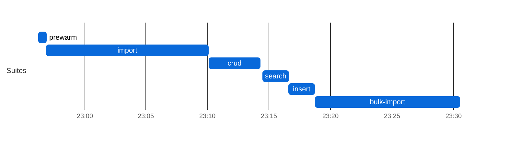
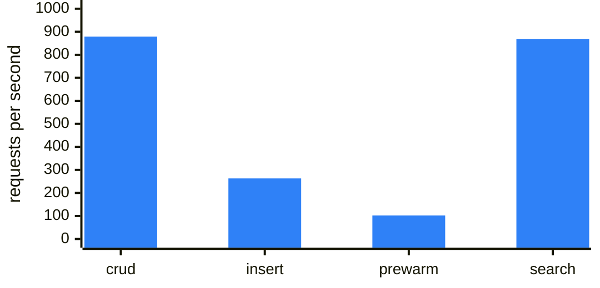
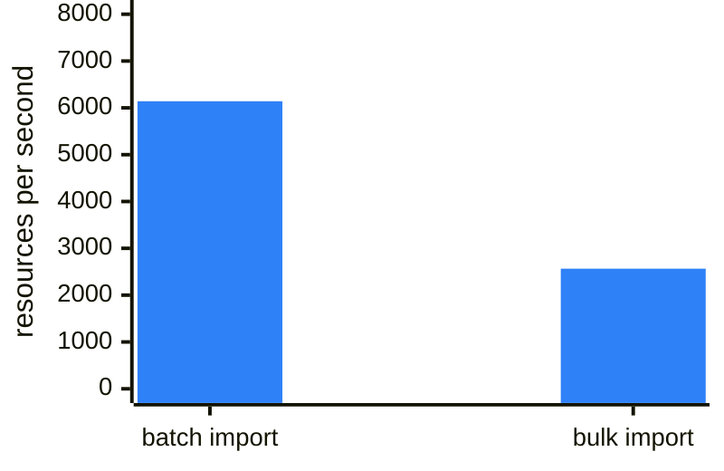

### Postgres tuning (postgres-elasticsearch)

| setting | value |
|---|---|
| Docker host RAM | 19G |
| shared_buffers | `2GB` |
| effective_cache_size | `6GB` |
| work_mem | `10MB` |
| max_wal_size | `8GB` |
| min_wal_size | `2GB` |
| wal_buffers | `256MB` |
| checkpoint_timeout | `15min` |
| data volume free space (start) | `173112 MB` |
### Elasticsearch tuning (postgres-elasticsearch)

| setting | value |
|---|---|
| image | `elasticsearch:8.15.0` (reports @@ES_VERSION@@), single node |
| JVM heap (-Xms = -Xmx) | `1024m` |
| HFS_COMPOSITE_SYNC_MODE | `synchronous` |
| HFS_ELASTICSEARCH_WRITE_REFRESH | `wait_for` |
| HFS_ELASTICSEARCH_REFRESH_INTERVAL | `200ms` |
| HFS_COMPOSITE_SYNC_REPAIR_INTERVAL | `60` |
| index replicas | 1 (hardcoded default in HFS) — cluster **yellow** on one node is expected |
| data volume free space (start) | `173112 MB (15% used)` |
### Search latency by query shape (postgres-elasticsearch)
| Query shape | n | median (ms) | p95 (ms) | max (ms) |
|---|---:|---:|---:|---:|
| `date Observation?date` | 4359 | 60 | 119 | 420 |
| `quantity Observation?combo-value-quantity` | 4359 | 53 | 109 | 213 |
| `quantity Observation?value-quantity` | 4359 | 50 | 105 | 269 |
| `token Observation?category` | 4359 | 43 | 86 | 424 |
| `quantity Observation?component-value-quantity` | 4359 | 46 | 80 | 239 |
| `token Observation?code` | 4359 | 33 | 62 | 245 |
| `date Encounter?date` | 4359 | 33 | 60 | 306 |
| `composite Observation?code-value-quantity` | 4359 | 31 | 57 | 354 |
| `composite Observation?combo-code-value-quantity` | 4359 | 30 | 55 | 238 |
| `composite Observation?component-code-value-quantity` | 4359 | 30 | 55 | 355 |
| `string Organization?name` | 4359 | 28 | 53 | 290 |
| `date Patient?birthdate` | 4359 | 28 | 53 | 174 |
| `token Encounter?class` | 4359 | 29 | 53 | 309 |
| `token Encounter?status` | 4359 | 28 | 52 | 240 |
| `reference Encounter?participant` | 4359 | 27 | 50 | 220 |
| `reference Encounter?subject` | 4359 | 27 | 50 | 223 |
| `reference Observation?subject` | 4359 | 27 | 49 | 123 |
| `string Patient?address` | 4359 | 27 | 49 | 223 |
| `reference MedicationRequest?subject` | 4359 | 26 | 49 | 139 |
| `reference Observation?encounter` | 4359 | 25 | 49 | 189 |
| `string Patient?name` | 4359 | 26 | 48 | 130 |
| `reference MedicationRequest?encounter` | 4359 | 25 | 48 | 218 |
| `reference MedicationRequest?requester` | 4359 | 26 | 48 | 182 |
| `reference Observation?performer` | 4359 | 24 | 48 | 128 |
| `? ??http://localhost:8085/Patient?_count=20&_elements=id` | 1 | 13 | 13 | 13 |
| `? ??http://localhost:8085/Encounter?_count=20&_elements=id` | 1 | 12 | 12 | 12 |
| `? ??http://localhost:8085/Practitioner?_count=20&_elements=id` | 1 | 3 | 3 | 3 |
## FHIR Benchmark — `main` (postgres-elasticsearch)

| | |
|---|---|
| **Commit**  | `e0bd5cb` |
| **Backend** | `postgres-elasticsearch` |
| **Suites**  | all |

### Leg configuration

| | |
|---|---|
| **Backend** | `postgres-elasticsearch` |
| **ES heap** | `1g` |
| **ES sync mode** | `synchronous` |
| **Legs at once (max_parallel)** | 1 |
| **Leg timeout** | 150 min |
| **Capacity gate** | need 6144 MB, available 17380 MB (source `docker-stats`), waited 2 s |

**Batch/Transaction Import** (`POST /` Bundles): 1,000/1000 bundles, 1,627,336 entries in 785 s — **6,141 resources/s** (3.77 Bundles/s) over the 265 s import scenario, after 520 s of k6 setup() (the two seed Bundles).

**Bulk Import (`$bulk-submit`):** 1,630,685/1,630,685 resources in 635.8 s (ingest until Completed 315.1 s + search-index rebuild 320.7 s, `completed`) = **2564.8 resources/s** end to end, 5175.1 resources/s ingest only; fresh database, `defer_indexing=true`.

Search check against the converted corpus: Patient 1,000/1,000 · Observation 689,080/689,080 · `Observation?code=8302-2,29463-7` 33,473/33,473 · `Encounter?class=AMB,EMER` 65,900/65,900 ✓

**ES drain:** status=`drained` (barrier HTTP 204 after 0 s); primary_live=1632062 es_live=1632062 missing=0 needs_reindex=0.

**Host load at crud start:** loadavg 8.85, 23 containers, 12617 MB MemAvailable on the Docker host (source `docker-stats`).

**How to read this leg.** Every search is answered by Elasticsearch; the primary's own search index is not written. In `synchronous` mode a write returns only after Elasticsearch has indexed it — bundles go through a per-resource-type `_bulk` request with `refresh=wait_for` against a 200ms `refresh_interval`, so **Batch/Transaction Import/crud/insert latency on this leg includes Elasticsearch indexing plus that refresh wait**, not just the primary. Every update and delete also runs a `_delete_by_query` with a forced refresh across all of the tenant's indices. Cluster health `yellow` is expected (1 replica per index, 1 node). Compare search latency with another leg only if both imported the same entry count and the ES drain above says `drained`.

### Result-size cross-check

| Query | Total | HTTP | Seconds |
|---|---:|---:|---:|
| `Patient?_summary=count` | 1000 | 200 | 0 |
| `Observation?_summary=count` | 689080 | 200 | 0 |
| `Encounter?_summary=count` | 67692 | 200 | 0 |
| `Patient?name:contains=an&_summary=count` | 353 | 200 | 0 |
| `Observation?date=ge2020-01-01&_summary=count` | 327171 | 200 | 0 |
| `Observation?date=sa2020-01-01&_summary=count` | 326951 | 200 | 0 |
| `Observation?code=8302-2,29463-7&_summary=count` | 33473 | 200 | 0 |
| `Observation?value-quantity=gt100&_summary=count` | 101155 | 200 | 0 |
| `Observation?value-quantity=sa100&_summary=count` | 101155 | 200 | 0 |
| `Observation?code-value-quantity=http://loinc.org%7C8867-4$gt100&_summary=count` | 222 | 200 | 0 |
| `Observation?combo-code-value-quantity=8480-6$gt140&_summary=count` | 1009 | 200 | 0 |
| `Encounter?class=AMB,EMER&_summary=count` | 65900 | 200 | 0 |

_totals include 0 crud/prewarm leftovers (Patient: 0) and any Batch/Transaction Import shortfall; a composite total equal to the Observation total means the name-only fallback; seconds after a 000 row overlap the previous query (HFS keeps executing after curl's --max-time)._

**Insert:** 31,765 create requests by 50 VUs, 263/s — Patient 6,353 created (p95 257.8 ms) · Observation 25,412 created (p95 242.2 ms). HFS's own suite (`.github/scripts/fhir-bench/k6/insert.js`, load shape in its header); it ran last, after the result-size snapshot, so its resources are not in those totals.
### Results

| Suite | Throughput | p50 ms | p95 ms | p99 ms | Err% | Checks ✓/✗ |
|-------|----:|-------:|-------:|-------:|-----:|-----------:|
| crud | 879 | 341.7 | 798.6 | 1036.2 | 0.0% | 216,000/0 |
| Batch/Transaction Import (`/ui/batch`: `POST /` Bundles) (resources/s; latency per Bundle) | 6,141 | 3486.4 | 10958.2 | 28387.0 | 0.0% | 1,000/0 |
| Bulk Import (`/ui/bulk-import`: `$bulk-submit`, until searchable) (resources/s) | 2,565 | n/a | n/a | n/a | 0.0% | 1,630,685/0 |
| insert | 263 | 204.7 | 247.1 | 263.2 | 0.0% | 31,765/0 |
| prewarm | 102 | 87.7 | 287.7 | 380.9 | 0.0% | 3,240/0 |
| search | 869 | 30.5 | 73.0 | 108.0 | 0.0% | 104,616/0 |

_Throughput is requests/s and latency is per request, except on the Batch/Transaction Import row (resources/s and per-Bundle latency, see the **Import** line above; k6 drives it with 20 concurrent clients); the Bulk Import row is resources/s end to end until searchable, with no per-request latency (see the **Bulk Import** line above)._

**Environment:** crud Postgres cost **0.06 ms/call** (62 s over 1,081,525 statements, host loadavg 8.85 over 23 containers at crud start). _(postgres-elasticsearch writes no search_index, so this is not comparable to bare postgres; contention threshold not applied)_

### Charts

Chart: postgres-elasticsearch run phases (UTC)

**postgres-elasticsearch: run phases (UTC)**

Each bar is one suite of this leg, from its start to its end (UTC, from host-contention.txt); gaps are setup between suites.

Chart: postgres-elasticsearch throughput and latency

**postgres-elasticsearch: k6 suites throughput (requests/s)**

One bar per k6 suite, higher is better; values in the Results table above.

**postgres-elasticsearch: Import throughput (resources/s)**

One bar per way of loading the corpus, higher is better; values in the Results table above (batch: committed Bundle entries per second of the k6 scenario; bulk: resources until the search index covers them).

**postgres-elasticsearch: latency per suite (ms)**

Overlaid bars per suite, light to dark blue: p99 (back), p95, p50 (front); lower is better; values in the Results table above (import, per Bundle, is left out).

```mermaid
%%{init: {"xyChart": {"width": 540, "height": 260, "useMaxWidth": false}, "themeVariables": {"xyChart": {"plotColorPalette": "#54aeff, #2f81f7, #0969da", "backgroundColor": "transparent"}}}}%%
xychart-beta
    x-axis ["crud", "insert", "prewarm", "search"]
    y-axis "ms" 0 --> 1200
    bar [1036.2, 263.2, 380.9, 108]
    bar [798.6, 247.1, 287.7, 73]
    bar [341.7, 204.7, 87.7, 30.5]
```

