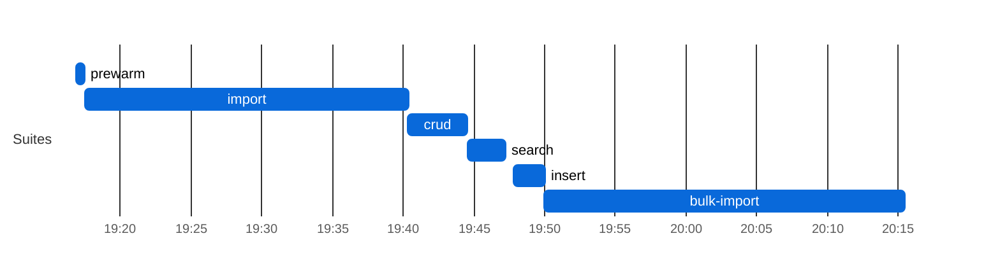
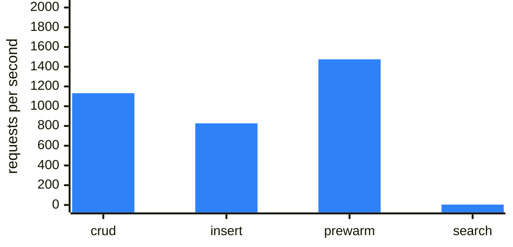
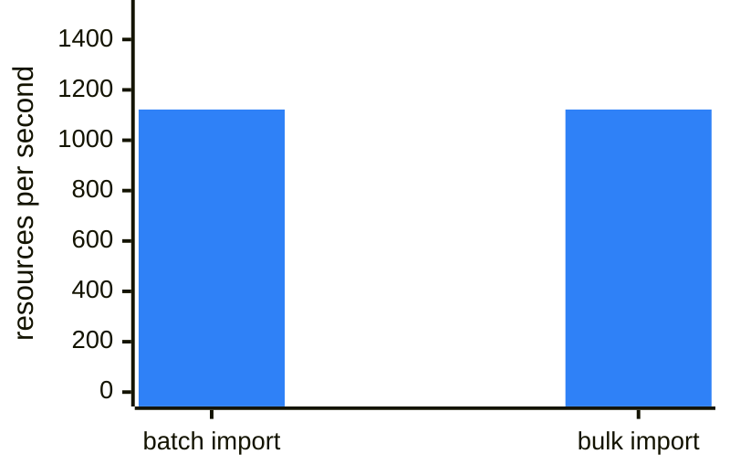

### Search latency by query shape (sqlite)
| Query shape | n | median (ms) | p95 (ms) | max (ms) |
|---|---:|---:|---:|---:|
| `quantity Observation?value-quantity` | 22 | 16219 | 38340 | 41078 |
| `composite Observation?combo-code-value-quantity` | 25 | 16098 | 25915 | 26476 |
| `composite Observation?code-value-quantity` | 23 | 14612 | 25154 | 25362 |
| `quantity Observation?combo-value-quantity` | 27 | 4866 | 24137 | 37865 |
| `token Observation?category` | 19 | 9503 | 17937 | 17937 |
| `date Observation?date` | 26 | 6722 | 15677 | 15813 |
| `reference MedicationRequest?subject` | 20 | 4947 | 15630 | 15630 |
| `quantity Observation?component-value-quantity` | 27 | 5316 | 15498 | 16701 |
| `token Encounter?class` | 23 | 7019 | 15075 | 15690 |
| `token Encounter?status` | 23 | 6827 | 15064 | 15971 |
| `string Patient?address` | 28 | 5831 | 14506 | 14531 |
| `reference Encounter?subject` | 21 | 5866 | 14382 | 14389 |
| `reference Observation?subject` | 20 | 4398 | 14268 | 14268 |
| `reference Observation?encounter` | 20 | 4426 | 13015 | 13015 |
| `composite Observation?component-code-value-quantity` | 22 | 8996 | 12970 | 14983 |
| `reference Encounter?participant` | 22 | 4559 | 12336 | 14918 |
| `reference MedicationRequest?requester` | 21 | 3517 | 9462 | 14230 |
| `reference MedicationRequest?encounter` | 20 | 4000 | 9071 | 9071 |
| `date Patient?birthdate` | 26 | 4631 | 8723 | 8898 |
| `token Observation?code` | 17 | 4966 | 8593 | 8593 |
| `string Organization?name` | 28 | 2344 | 8039 | 12210 |
| `reference Observation?performer` | 20 | 5491 | 7603 | 7603 |
| `date Encounter?date` | 27 | 3655 | 6890 | 9475 |
| `string Patient?name` | 27 | 3869 | 6190 | 8662 |
| `? ??http://localhost:8081/Patient?_count=20&_elements=id` | 1 | 664 | 664 | 664 |
| `? ??http://localhost:8081/Encounter?_count=20&_elements=id` | 1 | 270 | 270 | 270 |
| `? ??http://localhost:8081/Practitioner?_count=20&_elements=id` | 1 | 138 | 138 | 138 |
## FHIR Benchmark — `main` (sqlite)

| | |
|---|---|
| **Commit**  | `e0bd5cb` |
| **Backend** | `sqlite` |
| **Suites**  | all |

### Leg configuration

| | |
|---|---|
| **Backend** | `sqlite` |
| **Legs at once (max_parallel)** | 1 |
| **Leg timeout** | 150 min |
| **Capacity gate** | need 512 MB, available 16746 MB (source `docker-stats`), waited 2 s |

**Batch/Transaction Import** (`POST /` Bundles): 922/1000 bundles, 1,527,543 entries in 1365 s — **1,122 resources/s** (0.68 Bundles/s) over the 1,361 s import scenario, after 5 s of k6 setup() (the two seed Bundles). ⚠ **Batch/Transaction Import incomplete — crud/search on this leg ran on a smaller corpus and are not comparable to a 1000/1000 leg** (and abandoned Batch/Transaction Import requests may still have been running server-side)

**Bulk Import (`$bulk-submit`):** 1,630,685/1,630,685 resources in 1453.9 s (ingest until Completed 355.2 s + search-index rebuild 1098.7 s, `completed`) = **1121.6 resources/s** end to end, 4590.9 resources/s ingest only; fresh database, `defer_indexing=true`.

Search check against the converted corpus: Patient 1,000/1,000 · Observation 689,080/689,080 · `Observation?code=8302-2,29463-7` 33,473/33,473 · `Encounter?class=AMB,EMER` 65,900/65,900 ✓

**Host load at crud start:** loadavg 5.75, 17 containers, 14773 MB MemAvailable on the Docker host (source `docker-stats`).

### Result-size cross-check

| Query | Total | HTTP | Seconds |
|---|---:|---:|---:|
| `Patient?_summary=count` | 922 | 200 | 3 |
| `Observation?_summary=count` | 657369 | 200 | 1 |
| `Encounter?_summary=count` | 63316 | 200 | 0 |
| `Patient?name:contains=an&_summary=count` | 330 | 200 | 0 |
| `Observation?date=ge2020-01-01&_summary=count` | 307405 | 200 | 3 |
| `Observation?date=sa2020-01-01&_summary=count` | 307197 | 200 | 1 |
| `Observation?code=8302-2,29463-7&_summary=count` | 31506 | 200 | 3 |
| `Observation?value-quantity=gt100&_summary=count` | 95724 | 200 | 6 |
| `Observation?value-quantity=sa100&_summary=count` | 95724 | 200 | 5 |
| `Observation?code-value-quantity=http://loinc.org%7C8867-4$gt100&_summary=count` | 217 | 200 | 7 |
| `Observation?combo-code-value-quantity=8480-6$gt140&_summary=count` | 922 | 200 | 8 |
| `Encounter?class=AMB,EMER&_summary=count` | 61602 | 200 | 2 |

_totals include 0 crud/prewarm leftovers (Patient: 0) and any Batch/Transaction Import shortfall; a composite total equal to the Observation total means the name-only fallback; seconds after a 000 row overlap the previous query (HFS keeps executing after curl's --max-time)._

**Insert:** 102,415 create requests by 50 VUs, 827/s — Patient 20,483 created (p95 115.1 ms) · Observation 81,932 created (p95 113.0 ms). HFS's own suite (`.github/scripts/fhir-bench/k6/insert.js`, load shape in its header); it ran last, after the result-size snapshot, so its resources are not in those totals.
### Results

| Suite | Throughput | p50 ms | p95 ms | p99 ms | Err% | Checks ✓/✗ |
|-------|----:|-------:|-------:|-------:|-----:|-----------:|
| crud | 1,132 | 142.1 | 902.2 | 1606.3 | 0.0% | 279,612/0 |
| Batch/Transaction Import (`/ui/batch`: `POST /` Bundles) (resources/s; latency per Bundle) | 1,122 | 21619.7 | 60259.9 | 88429.5 | **3.9%** | **922/78** |
| Bulk Import (`/ui/bulk-import`: `$bulk-submit`, until searchable) (resources/s) | 1,122 | n/a | n/a | n/a | 0.0% | 1,630,685/0 |
| insert | 827 | 45.4 | 113.3 | 374.3 | 0.0% | 102,415/0 |
| prewarm | 1,475 | 2.0 | 20.6 | 93.3 | 0.0% | 44,496/0 |
| search | 4 | 5625.7 | 17373.9 | 32468.8 | 0.0% | 554/0 |

_Throughput is requests/s and latency is per request, except on the Batch/Transaction Import row (resources/s and per-Bundle latency, see the **Import** line above; k6 drives it with 20 concurrent clients); the Bulk Import row is resources/s end to end until searchable, with no per-request latency (see the **Bulk Import** line above)._

### Charts

Chart: sqlite run phases (UTC)

**sqlite: run phases (UTC)**

Each bar is one suite of this leg, from its start to its end (UTC, from host-contention.txt); gaps are setup between suites.

Chart: sqlite throughput and latency

**sqlite: k6 suites throughput (requests/s)**

One bar per k6 suite, higher is better; values in the Results table above; values span more than 50x, so read short bars in the table.

**sqlite: Import throughput (resources/s)**

One bar per way of loading the corpus, higher is better; values in the Results table above (batch: committed Bundle entries per second of the k6 scenario; bulk: resources until the search index covers them).

**sqlite: latency per suite (ms)**

Overlaid bars per suite, light to dark blue: p99 (back), p95, p50 (front); lower is better; values in the Results table above (import, per Bundle, is left out). Values span more than 50x; read small ones in the table.

```mermaid
%%{init: {"xyChart": {"width": 540, "height": 260, "useMaxWidth": false}, "themeVariables": {"xyChart": {"plotColorPalette": "#54aeff, #2f81f7, #0969da", "backgroundColor": "transparent"}}}}%%
xychart-beta
    x-axis ["crud", "insert", "prewarm", "search"]
    y-axis "ms" 0 --> 40000
    bar [1606.3, 374.3, 93.3, 32468.8]
    bar [902.2, 113.3, 20.6, 17373.9]
    bar [142.1, 45.4, 2, 5625.7]
```

