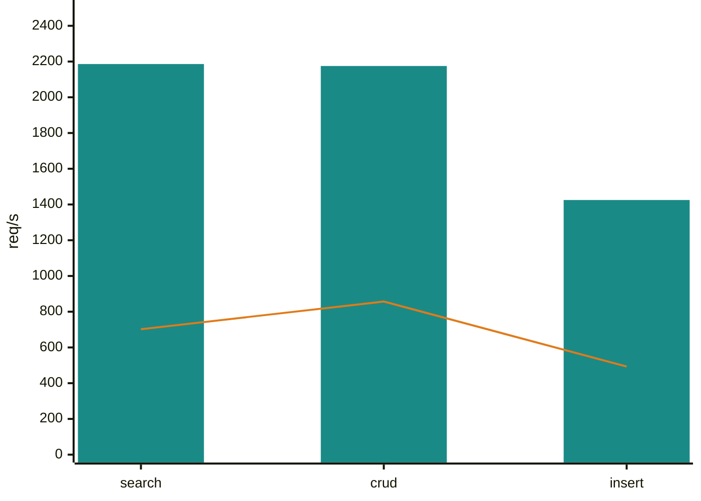
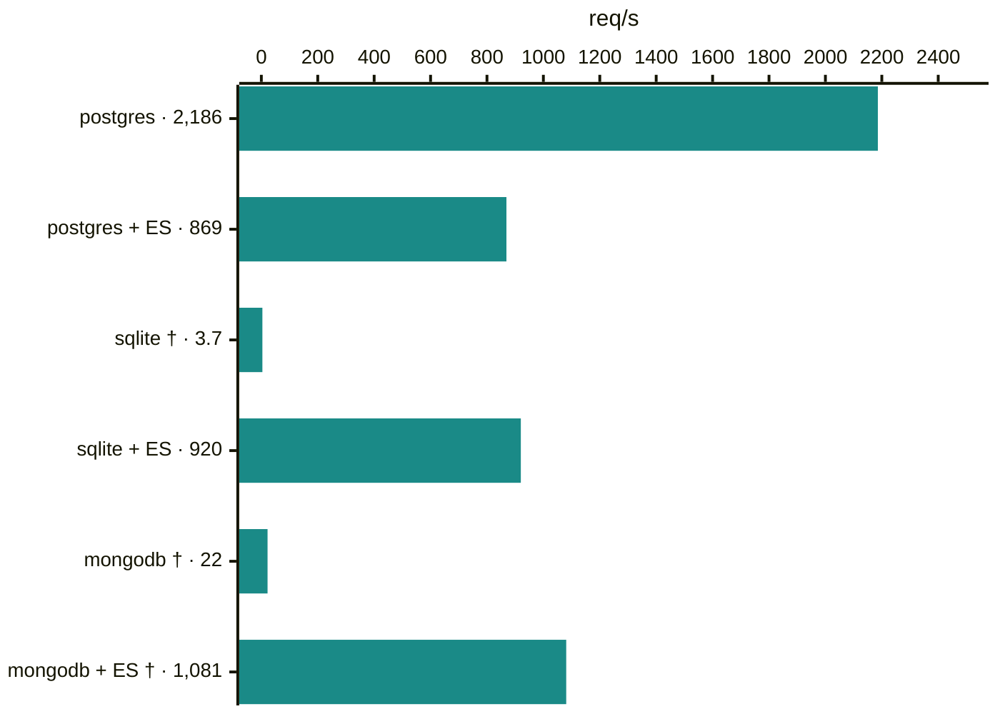
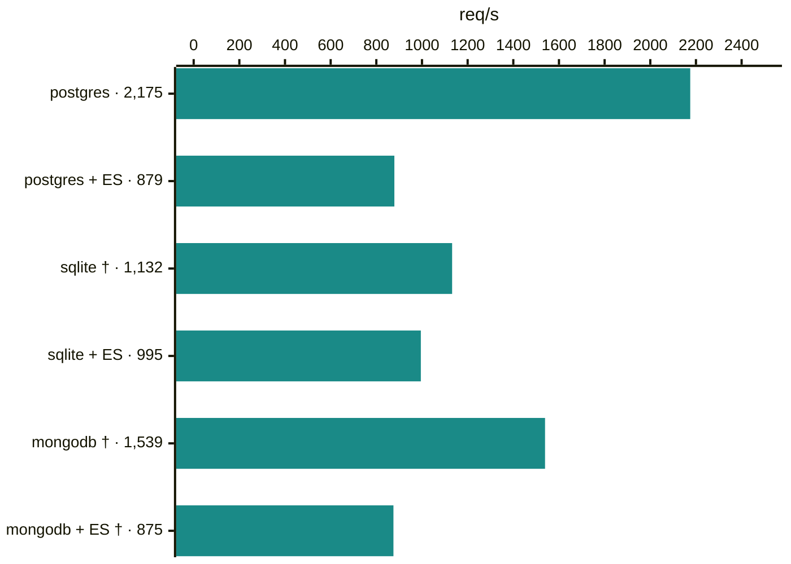
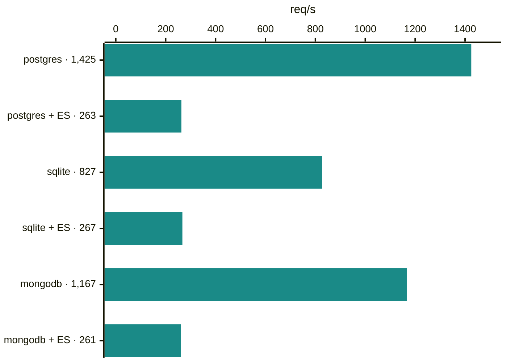
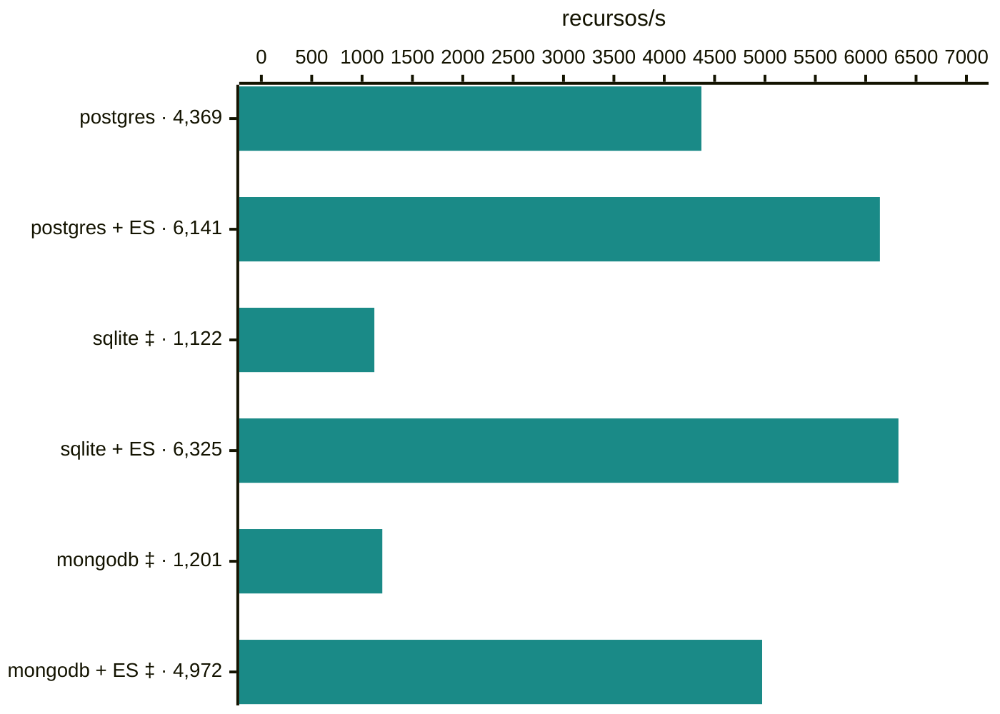
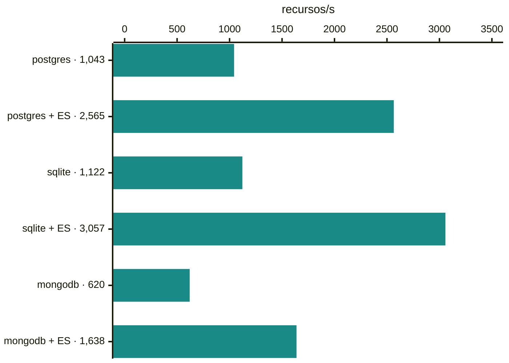
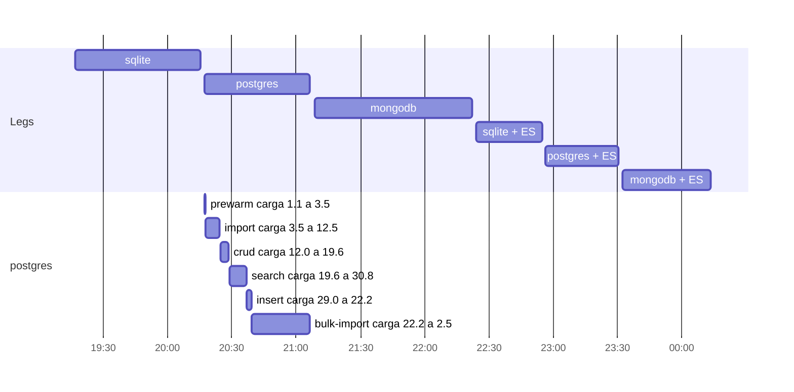
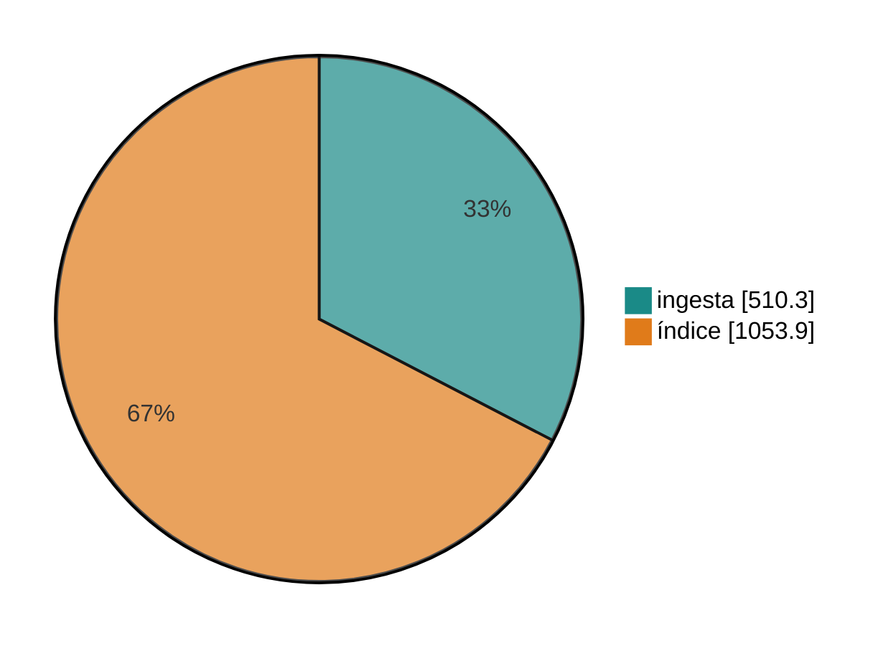

## Benchmark FHIR · corrida `39657850695`

Commit `e0bd5cb35` (`main`) · inicio 2026-10-21 19:16:55 UTC · 6 legs · leg titular: **postgres**

> 🟢 **Veredicto: postgres es válido; 3 de 6 legs con alguna falla.** Es una sola corrida en un host compartido: una muestra, no una prueba.

### 1. Validez

| Leg | Corpus importado | Errores | Contenedores | ES drenado | Carga del host (dato) |
|---|---|---|---|---|---|
| **postgres** | 🟢 ok 1,000/1,000 | 🟢 ok 0 % | 🟢 ok vivos | no aplica | loadavg pico 30.8 · pg 0.19 ms/llam. |
| postgres + ES | 🟢 ok 1,000/1,000 | 🟢 ok 0 % | 🟢 ok vivos | 🟢 ok drenado | loadavg pico 22.2 |
| sqlite | 🔴 falla 922/1,000 | 🔴 falla import 3.9 % | ⚪ sin contenedor | no aplica | loadavg pico 18.1 |
| sqlite + ES | 🟢 ok 1,000/1,000 | 🟢 ok 0 % | 🟢 ok vivos | 🟢 ok drenado | loadavg pico 16.6 |
| mongodb | 🔴 falla 989/1,000 | 🟡 aviso import 11 ✗ (<1 %) | 🟢 ok vivos | no aplica | loadavg pico 30.0 |
| mongodb + ES | 🔴 falla 996/1,000 | 🟡 aviso import 4 ✗ (<1 %) | 🟢 ok vivos | 🟢 ok drenado | loadavg pico 19.1 |

- 🔴 sqlite, mongodb, mongodb + ES: corpus incompleto (922/1,000, 989/1,000, 996/1,000); su crud y search corrieron sobre menos datos y no se comparan.
- 🔴 sqlite, mongodb, mongodb + ES: errores o checks fallidos (import 3.9 %, import 11 ✗ (<1 %), import 4 ✗ (<1 %)); revisar la tabla completa.

_Corpus: Bundles importados de 1000; errores: más de 1 % de pedidos fallidos es falla, checks fallidos por debajo de eso es aviso. La carga es el loadavg de 1 minuto del host Docker compartido (pico entre las lecturas de cada fase), host declarado con 4 CPU; se muestra sin juicio porque no sabemos con certeza contra cuántas CPU compararla._

### 2. Resultados de postgres

| Suite | Rendimiento | p50 | p95 | p99 | Err % | vs `38564965562` (indicativo, 1 corrida) |
|---|---:|---:|---:|---:|---:|---|
| search | 2,186 req/s | 7.7 ms | 40 ms | 114 ms | 0.00 | ▲ sube +211 % (antes 702) |
| crud | 2,175 req/s | 123 ms | 290 ms | 416 ms | 0.00 | ▲ sube +154 % (antes 857) |
| insert | 1,425 req/s | 32 ms | 58 ms | 103 ms | 0.00 | ▲ sube +189 % (antes 493) |
| import | 4,369 recursos/s | 2.7 s | 26.6 s | 66.4 s | 0.00 | ▼ baja -7 % (antes 4,705) |
| bulk import | 1,043 recursos/s | | | | 0.00 | ▲ sube +8 % (antes 964) |

_Import: latencia por Bundle completo. El delta compara con una sola corrida anterior, en otro momento y con otra carga del host: orienta, no prueba mejora ni empeoramiento._

### 3. Gráficos

**postgres: req/s por suite, esta corrida y la anterior**

_Cómo leer esto: cada barra verde azulada es esta corrida; la línea naranja es la corrida `38564965562` (un punto en 0 es «sin datos»); más alto es mejor._

**postgres: latencia p50, p95 y p99 (ms)**

```mermaid
%%{init: {"themeVariables": {"xyChart": {"plotColorPalette": "#8B6FC9, #E07B1A, #1A8A87"}}}}%%
xychart-beta
    x-axis ["search", "crud", "insert"]
    y-axis "ms" 0 --> 450
    bar [114, 416, 103]
    bar [40, 290, 58]
    bar [7.7, 123, 32]
```

_Cómo leer esto: barras superpuestas, de atrás hacia adelante p99 (violeta), p95 (naranja) y p50 (verde azulado); menos es mejor. Import (por Bundle, en segundos) está en la tabla de arriba._

**Rendimiento por suite en las 6 legs**

_Cómo leer esto: un gráfico por suite, cada uno con su propia escala y el valor junto al nombre de la leg; más largo es mejor y las marcas † ‡ ⚠ avisan que ese número no es comparable (ver Glosario)._

_search, req/s (escala muy dispar: la barra más corta casi no se ve, su valor está en la etiqueta)_

_crud, req/s_

_insert, req/s_

_import, recursos/s_

_bulk import, recursos/s_

**Línea de tiempo de la corrida (UTC)**

_Cómo leer esto: arriba, cuándo corrió cada leg (una tras otra); abajo, las fases de postgres con el loadavg de 1 minuto del host al empezar y al terminar cada una._

**postgres: bulk import por fase (segundos)**

_Cómo leer esto: el tiempo oficial (1,564 s) es ingesta más índice; la conversión previa (47 s) no cuenta._

### 4. Detalle

<b>Rendimiento de todas las legs</b> (req/s; import y bulk en recursos/s)

| Leg | search | crud | insert | import | bulk import | prewarm |
|---|---:|---:|---:|---:|---:|---:|
| postgres | 2,186 | 2,175 | 1,425 | 4,369 | 1,043 | 1,867 |
| postgres + ES | 869 | 879 | 263 | 6,141 | 2,565 | 102 |
| sqlite | 3.7 † | 1,132 † | 827 | 1,122 ‡ | 1,122 | 1,475 |
| sqlite + ES | 920 | 995 | 267 | 6,325 | 3,057 | 90 |
| mongodb | 22 † | 1,539 † | 1,167 | 1,201 ‡ | 620 | 1,232 |
| mongodb + ES | 1,081 † | 875 † | 261 | 4,972 ‡ | 1,638 | 97 |

<b>Latencia p50 · p95 · p99 de todas las legs</b>

| Leg | search | crud | insert | import (por Bundle) |
|---|---|---|---|---|
| postgres | 7.7 ms · **40 ms** · 114 ms | 123 ms · **290 ms** · 416 ms | 32 ms · **58 ms** · 103 ms | 2.7 s · **26.6 s** · 66.4 s |
| postgres + ES | 30 ms · **73 ms** · 108 ms | 342 ms · **799 ms** · 1.0 s | 205 ms · **247 ms** · 263 ms | 3.5 s · **11.0 s** · 28.4 s |
| sqlite | 5.6 s · **17.4 s** · 32.5 s | 142 ms · **902 ms** · 1.6 s | 45 ms · **113 ms** · 374 ms | 21.6 s · **60.3 s** · 88.4 s |
| sqlite + ES | 29 ms · **69 ms** · 101 ms | 295 ms · **749 ms** · 974 ms | 203 ms · **244 ms** · 260 ms | 3.5 s · **10.3 s** · 24.4 s |
| mongodb | 137 ms · **9.4 s** · 13.1 s | 206 ms · **380 ms** · 537 ms | 39 ms · **71 ms** · 112 ms | 18.5 s · **49.3 s** · 61.2 s |
| mongodb + ES | 24 ms · **61 ms** · 92 ms | 340 ms · **826 ms** · 1.0 s | 205 ms · **250 ms** · 270 ms | 4.2 s · **13.5 s** · 24.8 s |

_p95 en negrita. Máximo por suite en la tabla de errores._

<b>Errores y checks por suite</b>

| Leg | Suite | Pedidos | Err % | Checks ok | Checks fallidos | VU máx. | Latencia máx. |
|---|---|---:|---:|---:|---:|---:|---:|
| postgres | prewarm | 56,520 | 0.00 | 56,520 | 0 | 10 | 64 ms |
| postgres | import | 2,005 | 0.00 | 1,000 | 0 | 20 | 171.5 s |
| postgres | crud | 526,680 | 0.00 | 526,680 | 0 | 300 | 1.7 s |
| postgres | search | 262,875 | 0.00 | 262,872 | 0 | 30 | 26.5 s |
| postgres | insert | 171,220 | 0.00 | 171,220 | 0 | 50 | 638 ms |
| postgres + ES | prewarm | 3,240 | 0.00 | 3,240 | 0 | 10 | 841 ms |
| postgres + ES | import | 2,005 | 0.00 | 1,000 | 0 | 20 | 61.1 s |
| postgres + ES | crud | 216,000 | 0.00 | 216,000 | 0 | 300 | 1.9 s |
| postgres + ES | search | 104,619 | 0.00 | 104,616 | 0 | 30 | 424 ms |
| postgres + ES | insert | 31,765 | 0.00 | 31,765 | 0 | 50 | 293 ms |
| sqlite | prewarm | 44,496 | 0.00 | 44,496 | 0 | 10 | 1.7 s |
| sqlite | import ‡ | 2,005 | 3.89 | 922 | 78 | 20 | 260.0 s |
| sqlite | crud † | 279,612 | 0.00 | 279,612 | 0 | 300 | 11.3 s |
| sqlite | search † | 557 | 0.00 | 554 | 0 | 30 | 41.1 s |
| sqlite | insert | 102,415 | 0.00 | 102,415 | 0 | 50 | 14.6 s |
| sqlite + ES | prewarm | 2,988 | 0.00 | 2,988 | 0 | 10 | 872 ms |
| sqlite + ES | import | 2,005 | 0.00 | 1,000 | 0 | 20 | 57.3 s |
| sqlite + ES | crud | 248,112 | 0.00 | 248,112 | 0 | 300 | 1.6 s |
| sqlite + ES | search | 110,811 | 0.00 | 110,808 | 0 | 30 | 484 ms |
| sqlite + ES | insert | 32,230 | 0.00 | 32,230 | 0 | 50 | 316 ms |
| mongodb | prewarm | 37,260 | 0.00 | 37,260 | 0 | 10 | 56 ms |
| mongodb | import ‡ | 2,005 | 0.55 | 989 | 11 | 20 | 86.3 s |
| mongodb | crud † | 377,856 | 0.00 | 377,856 | 0 | 300 | 1.7 s |
| mongodb | search † | 3,051 | 0.00 | 3,048 | 0 | 30 | 117.9 s |
| mongodb | insert | 140,190 | 0.00 | 140,190 | 0 | 50 | 669 ms |
| mongodb + ES | prewarm | 3,240 | 0.00 | 3,240 | 0 | 10 | 813 ms |
| mongodb + ES | import ‡ | 2,005 | 0.20 | 996 | 4 | 20 | 37.4 s |
| mongodb + ES | crud † | 216,000 | 0.00 | 216,000 | 0 | 300 | 1.8 s |
| mongodb + ES | search † | 130,179 | 0.00 | 130,176 | 0 | 30 | 521 ms |
| mongodb + ES | insert | 31,565 | 0.00 | 31,565 | 0 | 50 | 361 ms |

<b>Bulk import por fase</b> (segundos)

| Leg | Estado | Conversión | Ingesta | Índice | Total | Recursos/s | Ingesta rec./s | Recursos ok | Fallidos | Índice | Buscable |
|---|---|---:|---:|---:|---:|---:|---:|---:|---:|---|---|
| postgres | complete | 47 | 510 | 1,054 | 1,564 | 1,043 | 3,196 | 1,630,685 | 0 | completed | sí |
| postgres + ES | complete | 44 | 315 | 321 | 636 | 2,565 | 5,175 | 1,630,685 | 0 | completed | sí |
| sqlite | complete | 47 | 355 | 1,099 | 1,454 | 1,122 | 4,591 | 1,630,685 | 0 | completed | sí |
| sqlite + ES | complete | 45 | 220 | 313 | 533 | 3,057 | 7,409 | 1,630,685 | 0 | completed | sí |
| mongodb | complete | 46 | 931 | 1,698 | 2,628 | 620 | 1,753 | 1,630,685 | 0 | completed | sí |
| mongodb + ES | complete | 45 | 645 | 350 | 996 | 1,638 | 2,527 | 1,630,685 | 0 | completed | sí |

<b>Búsqueda: tamaño de resultados por leg</b> (control cruzado)

| Consulta | postgres | postgres + ES | sqlite | sqlite + ES | mongodb | mongodb + ES |
|---|---:|---:|---:|---:|---:|---:|
| `Patient?_summary=count` | 1,000 | 1,000 | 922 ≠ | 1,000 | 989 ≠ | 996 ≠ |
| `Observation?_summary=count` | 689,080 | 689,080 | 657,369 ≠ | 689,080 | 564,051 ≠ | 626,637 ≠ |
| `Encounter?_summary=count` | 67,692 | 67,692 | 63,316 ≠ | 67,692 | 56,497 ≠ | 62,962 ≠ |
| `Patient?name:contains=an&_summary=count` | 353 | 353 | 330 ≠ | 353 | 348 ≠ | 353 |
| `Observation?date=ge2020-01-01&_summary=count` | 327,171 | 327,171 | 307,405 ≠ | 327,171 | 269,919 ≠ | 296,434 ≠ |
| `Observation?date=sa2020-01-01&_summary=count` | 326,951 | 326,951 | 307,197 ≠ | 326,951 | 269,734 ≠ | 296,214 ≠ |
| `Observation?code=8302-2,29463-7&_summary=count` | 33,473 | 33,473 | 31,506 ≠ | 33,473 | 30,291 ≠ | 31,961 ≠ |
| `Observation?value-quantity=gt100&_summary=count` | 101,155 | 101,155 | 95,724 ≠ | 101,155 | 83,180 ≠ | 91,647 ≠ |
| `Observation?value-quantity=sa100&_summary=count` | 101,155 | 101,155 | 95,724 ≠ | 101,155 | 83,180 ≠ | 91,647 ≠ |
| `Observation?code-value-quantity=http://loinc.org%7C8867-4$gt100&_summary=count` | 222 | 222 | 217 ≠ | 222 | 222 | 222 |
| `Observation?combo-code-value-quantity=8480-6$gt140&_summary=count` | 1,009 | 1,009 | 922 ≠ | 1,009 | 1,003 ≠ | 1,003 ≠ |
| `Encounter?class=AMB,EMER&_summary=count` | 65,900 | 65,900 | 61,602 ≠ | 65,900 | 54,762 ≠ | 61,208 ≠ |

_≠ marca un total distinto del de postgres; 33 diferencias._

<b>Búsqueda por forma de consulta: postgres</b> (24 formas, de la más lenta a la más rápida por p95)

| Tipo | Consulta | n | p50 | p95 | máx. |
|---|---|---:|---:|---:|---:|
| composite | `Observation?code-value-quantity` | 10,953 | 18 ms | 175 ms | 707 ms |
| composite | `Observation?component-code-value-quantity` | 10,953 | 12 ms | 164 ms | 1.6 s |
| string | `Patient?address` | 10,953 | 11 ms | 59 ms | 3.7 s |
| composite | `Observation?combo-code-value-quantity` | 10,953 | 11 ms | 58 ms | 369 ms |
| string | `Patient?name` | 10,953 | 9.1 ms | 47 ms | 494 ms |
| reference | `MedicationRequest?requester` | 10,953 | 6.9 ms | 37 ms | 1.1 s |
| quantity | `Observation?component-value-quantity` | 10,953 | 11 ms | 37 ms | 273 ms |
| quantity | `Observation?combo-value-quantity` | 10,953 | 9.4 ms | 36 ms | 375 ms |
| date | `Encounter?date` | 10,953 | 6.2 ms | 35 ms | 349 ms |
| reference | `Observation?subject` | 10,953 | 8.0 ms | 34 ms | 354 ms |
| quantity | `Observation?value-quantity` | 10,953 | 8.9 ms | 34 ms | 459 ms |
| date | `Observation?date` | 10,953 | 7.1 ms | 33 ms | 4.0 s |
| reference | `Encounter?participant` | 10,953 | 7.1 ms | 28 ms | 514 ms |
| token | `Observation?code` | 10,953 | 6.8 ms | 28 ms | 290 ms |
| token | `Observation?category` | 10,953 | 7.2 ms | 27 ms | 316 ms |
| token | `Encounter?class` | 10,953 | 6.9 ms | 27 ms | 26.5 s |
| date | `Patient?birthdate` | 10,953 | 7.1 ms | 26 ms | 293 ms |
| reference | `Encounter?subject` | 10,953 | 6.8 ms | 26 ms | 317 ms |
| token | `Encounter?status` | 10,953 | 6.0 ms | 25 ms | 316 ms |
| reference | `MedicationRequest?subject` | 10,953 | 6.0 ms | 25 ms | 308 ms |
| reference | `Observation?encounter` | 10,953 | 6.3 ms | 24 ms | 259 ms |
| string | `Organization?name` | 10,953 | 5.5 ms | 24 ms | 352 ms |
| reference | `MedicationRequest?encounter` | 10,953 | 5.5 ms | 22 ms | 317 ms |
| reference | `Observation?performer` | 10,953 | 4.9 ms | 22 ms | 339 ms |

<b>Búsqueda por forma de consulta: postgres + ES</b> (24 formas, de la más lenta a la más rápida por p95)

| Tipo | Consulta | n | p50 | p95 | máx. |
|---|---|---:|---:|---:|---:|
| date | `Observation?date` | 4,359 | 60 ms | 119 ms | 420 ms |
| quantity | `Observation?combo-value-quantity` | 4,359 | 53 ms | 109 ms | 213 ms |
| quantity | `Observation?value-quantity` | 4,359 | 50 ms | 105 ms | 269 ms |
| token | `Observation?category` | 4,359 | 43 ms | 86 ms | 424 ms |
| quantity | `Observation?component-value-quantity` | 4,359 | 46 ms | 80 ms | 239 ms |
| token | `Observation?code` | 4,359 | 33 ms | 62 ms | 245 ms |
| date | `Encounter?date` | 4,359 | 33 ms | 60 ms | 306 ms |
| composite | `Observation?code-value-quantity` | 4,359 | 31 ms | 57 ms | 354 ms |
| composite | `Observation?combo-code-value-quantity` | 4,359 | 30 ms | 55 ms | 238 ms |
| composite | `Observation?component-code-value-quantity` | 4,359 | 30 ms | 55 ms | 355 ms |
| string | `Organization?name` | 4,359 | 28 ms | 53 ms | 290 ms |
| date | `Patient?birthdate` | 4,359 | 28 ms | 53 ms | 174 ms |
| token | `Encounter?class` | 4,359 | 29 ms | 53 ms | 309 ms |
| token | `Encounter?status` | 4,359 | 28 ms | 52 ms | 240 ms |
| reference | `Encounter?participant` | 4,359 | 27 ms | 50 ms | 220 ms |
| reference | `Encounter?subject` | 4,359 | 27 ms | 50 ms | 223 ms |
| reference | `Observation?subject` | 4,359 | 27 ms | 49 ms | 123 ms |
| string | `Patient?address` | 4,359 | 27 ms | 49 ms | 223 ms |
| reference | `MedicationRequest?subject` | 4,359 | 26 ms | 49 ms | 139 ms |
| reference | `Observation?encounter` | 4,359 | 25 ms | 49 ms | 189 ms |
| string | `Patient?name` | 4,359 | 26 ms | 48 ms | 130 ms |
| reference | `MedicationRequest?encounter` | 4,359 | 25 ms | 48 ms | 218 ms |
| reference | `MedicationRequest?requester` | 4,359 | 26 ms | 48 ms | 182 ms |
| reference | `Observation?performer` | 4,359 | 24 ms | 48 ms | 128 ms |

<b>Búsqueda por forma de consulta: sqlite</b> (24 formas, de la más lenta a la más rápida por p95)

| Tipo | Consulta | n | p50 | p95 | máx. |
|---|---|---:|---:|---:|---:|
| quantity | `Observation?value-quantity` | 22 | 16.2 s | 38.3 s | 41.1 s |
| composite | `Observation?combo-code-value-quantity` | 25 | 16.1 s | 25.9 s | 26.5 s |
| composite | `Observation?code-value-quantity` | 23 | 14.6 s | 25.2 s | 25.4 s |
| quantity | `Observation?combo-value-quantity` | 27 | 4.9 s | 24.1 s | 37.9 s |
| token | `Observation?category` | 19 | 9.5 s | 17.9 s | 17.9 s |
| date | `Observation?date` | 26 | 6.7 s | 15.7 s | 15.8 s |
| reference | `MedicationRequest?subject` | 20 | 4.9 s | 15.6 s | 15.6 s |
| quantity | `Observation?component-value-quantity` | 27 | 5.3 s | 15.5 s | 16.7 s |
| token | `Encounter?class` | 23 | 7.0 s | 15.1 s | 15.7 s |
| token | `Encounter?status` | 23 | 6.8 s | 15.1 s | 16.0 s |
| string | `Patient?address` | 28 | 5.8 s | 14.5 s | 14.5 s |
| reference | `Encounter?subject` | 21 | 5.9 s | 14.4 s | 14.4 s |
| reference | `Observation?subject` | 20 | 4.4 s | 14.3 s | 14.3 s |
| reference | `Observation?encounter` | 20 | 4.4 s | 13.0 s | 13.0 s |
| composite | `Observation?component-code-value-quantity` | 22 | 9.0 s | 13.0 s | 15.0 s |
| reference | `Encounter?participant` | 22 | 4.6 s | 12.3 s | 14.9 s |
| reference | `MedicationRequest?requester` | 21 | 3.5 s | 9.5 s | 14.2 s |
| reference | `MedicationRequest?encounter` | 20 | 4.0 s | 9.1 s | 9.1 s |
| date | `Patient?birthdate` | 26 | 4.6 s | 8.7 s | 8.9 s |
| token | `Observation?code` | 17 | 5.0 s | 8.6 s | 8.6 s |
| string | `Organization?name` | 28 | 2.3 s | 8.0 s | 12.2 s |
| reference | `Observation?performer` | 20 | 5.5 s | 7.6 s | 7.6 s |
| date | `Encounter?date` | 27 | 3.7 s | 6.9 s | 9.5 s |
| string | `Patient?name` | 27 | 3.9 s | 6.2 s | 8.7 s |

<b>Búsqueda por forma de consulta: sqlite + ES</b> (24 formas, de la más lenta a la más rápida por p95)

| Tipo | Consulta | n | p50 | p95 | máx. |
|---|---|---:|---:|---:|---:|
| date | `Observation?date` | 4,617 | 59 ms | 113 ms | 381 ms |
| quantity | `Observation?combo-value-quantity` | 4,617 | 51 ms | 101 ms | 342 ms |
| quantity | `Observation?value-quantity` | 4,617 | 48 ms | 99 ms | 201 ms |
| token | `Observation?category` | 4,617 | 38 ms | 80 ms | 484 ms |
| quantity | `Observation?component-value-quantity` | 4,617 | 46 ms | 78 ms | 298 ms |
| token | `Observation?code` | 4,617 | 31 ms | 57 ms | 167 ms |
| composite | `Observation?code-value-quantity` | 4,617 | 30 ms | 56 ms | 312 ms |
| date | `Encounter?date` | 4,617 | 30 ms | 53 ms | 335 ms |
| composite | `Observation?combo-code-value-quantity` | 4,617 | 29 ms | 53 ms | 218 ms |
| composite | `Observation?component-code-value-quantity` | 4,617 | 28 ms | 52 ms | 276 ms |
| string | `Organization?name` | 4,617 | 27 ms | 50 ms | 342 ms |
| date | `Patient?birthdate` | 4,617 | 26 ms | 50 ms | 106 ms |
| token | `Encounter?class` | 4,617 | 27 ms | 50 ms | 217 ms |
| token | `Encounter?status` | 4,617 | 26 ms | 49 ms | 223 ms |
| reference | `Encounter?subject` | 4,617 | 25 ms | 48 ms | 221 ms |
| string | `Patient?address` | 4,617 | 26 ms | 48 ms | 198 ms |
| reference | `Observation?subject` | 4,617 | 25 ms | 48 ms | 94 ms |
| reference | `Encounter?participant` | 4,617 | 26 ms | 48 ms | 202 ms |
| reference | `MedicationRequest?subject` | 4,617 | 25 ms | 47 ms | 183 ms |
| reference | `MedicationRequest?encounter` | 4,617 | 24 ms | 47 ms | 151 ms |
| reference | `MedicationRequest?requester` | 4,617 | 24 ms | 46 ms | 84 ms |
| string | `Patient?name` | 4,617 | 24 ms | 46 ms | 127 ms |
| reference | `Observation?encounter` | 4,617 | 23 ms | 46 ms | 112 ms |
| reference | `Observation?performer` | 4,617 | 23 ms | 45 ms | 104 ms |

<b>Búsqueda por forma de consulta: mongodb</b> (24 formas, de la más lenta a la más rápida por p95)

| Tipo | Consulta | n | p50 | p95 | máx. |
|---|---|---:|---:|---:|---:|
| composite | `Observation?code-value-quantity` | 127 | 9.3 s | 15.4 s | 16.6 s |
| composite | `Observation?component-code-value-quantity` | 127 | 9.0 s | 13.6 s | 15.4 s |
| composite | `Observation?combo-code-value-quantity` | 127 | 8.6 s | 11.8 s | 13.3 s |
| date | `Observation?date` | 127 | 151 ms | 3.5 s | 7.9 s |
| quantity | `Observation?component-value-quantity` | 127 | 530 ms | 950 ms | 1.7 s |
| quantity | `Observation?value-quantity` | 127 | 175 ms | 789 ms | 966 ms |
| quantity | `Observation?combo-value-quantity` | 127 | 152 ms | 716 ms | 1.3 s |
| token | `Observation?code` | 127 | 406 ms | 700 ms | 1.0 s |
| token | `Observation?category` | 127 | 137 ms | 699 ms | 870 ms |
| token | `Encounter?class` | 127 | 155 ms | 510 ms | 684 ms |
| date | `Encounter?date` | 127 | 124 ms | 491 ms | 14.1 s |
| string | `Patient?address` | 127 | 254 ms | 485 ms | 900 ms |
| reference | `MedicationRequest?requester` | 127 | 100 ms | 393 ms | 503 ms |
| reference | `Encounter?participant` | 127 | 118 ms | 391 ms | 642 ms |
| date | `Patient?birthdate` | 127 | 123 ms | 364 ms | 678 ms |
| string | `Patient?name` | 127 | 135 ms | 341 ms | 539 ms |
| reference | `Observation?subject` | 127 | 122 ms | 244 ms | 429 ms |
| token | `Encounter?status` | 127 | 96 ms | 236 ms | 322 ms |
| string | `Organization?name` | 127 | 64 ms | 216 ms | 774 ms |
| reference | `Observation?performer` | 127 | 76 ms | 196 ms | 243 ms |
| reference | `Encounter?subject` | 127 | 73 ms | 194 ms | 265 ms |
| reference | `Observation?encounter` | 127 | 61 ms | 179 ms | 117.9 s |
| reference | `MedicationRequest?subject` | 127 | 81 ms | 170 ms | 285 ms |
| reference | `MedicationRequest?encounter` | 127 | 59 ms | 169 ms | 285 ms |

<b>Búsqueda por forma de consulta: mongodb + ES</b> (24 formas, de la más lenta a la más rápida por p95)

| Tipo | Consulta | n | p50 | p95 | máx. |
|---|---|---:|---:|---:|---:|
| date | `Observation?date` | 5,424 | 50 ms | 101 ms | 444 ms |
| quantity | `Observation?combo-value-quantity` | 5,424 | 44 ms | 93 ms | 366 ms |
| quantity | `Observation?value-quantity` | 5,424 | 39 ms | 89 ms | 335 ms |
| token | `Observation?category` | 5,424 | 34 ms | 72 ms | 521 ms |
| quantity | `Observation?component-value-quantity` | 5,424 | 38 ms | 66 ms | 318 ms |
| date | `Encounter?date` | 5,424 | 26 ms | 49 ms | 336 ms |
| composite | `Observation?code-value-quantity` | 5,424 | 25 ms | 48 ms | 338 ms |
| token | `Observation?code` | 5,424 | 26 ms | 48 ms | 253 ms |
| composite | `Observation?component-code-value-quantity` | 5,424 | 23 ms | 45 ms | 337 ms |
| composite | `Observation?combo-code-value-quantity` | 5,424 | 23 ms | 45 ms | 261 ms |
| token | `Encounter?class` | 5,424 | 23 ms | 44 ms | 243 ms |
| string | `Organization?name` | 5,424 | 23 ms | 44 ms | 258 ms |
| date | `Patient?birthdate` | 5,424 | 23 ms | 44 ms | 256 ms |
| reference | `Encounter?subject` | 5,424 | 22 ms | 43 ms | 256 ms |
| token | `Encounter?status` | 5,424 | 22 ms | 43 ms | 254 ms |
| reference | `Observation?subject` | 5,424 | 21 ms | 43 ms | 141 ms |
| string | `Patient?address` | 5,424 | 21 ms | 42 ms | 153 ms |
| reference | `Encounter?participant` | 5,424 | 21 ms | 42 ms | 245 ms |
| reference | `MedicationRequest?encounter` | 5,424 | 20 ms | 41 ms | 195 ms |
| reference | `MedicationRequest?requester` | 5,424 | 20 ms | 41 ms | 255 ms |
| string | `Patient?name` | 5,424 | 20 ms | 41 ms | 207 ms |
| reference | `MedicationRequest?subject` | 5,424 | 20 ms | 41 ms | 179 ms |
| reference | `Observation?encounter` | 5,424 | 19 ms | 40 ms | 197 ms |
| reference | `Observation?performer` | 5,424 | 18 ms | 39 ms | 253 ms |

<b>Diagnóstico por leg</b> (runner, contenedores, ES, carga por fase)

| Leg | Runner | CPU / RAM del runner | Contenedores | Residuo crud | ES (estado, faltantes, sync) | Postgres ms/llam. | Datos de búsqueda |
|---|---|---|---|---:|---|---:|---|
| postgres | github-agent6 | 8 / 23G | hfs-bench-pg-postgres-39657850695 OOMKilled=false Status=running | 0 | no aplica | 0.188 | search-points.json |
| postgres + ES | github-agent2 | 8 / 23G | hfs-bench-pg-postgres-elasticsearch-39657850695 OOMKilled=false Status=running; hfs-bench-es-postgres-elasticsearch-39657850695 OOMKilled=false Status=running | 0 | drained, 0, synchronous | – | search-points.json |
| sqlite | github-agent2 | 8 / 23G | sin contenedor | 0 | no aplica | – | search-points.json |
| sqlite + ES | github-agent1 | 8 / 23G | hfs-bench-es-sqlite-elasticsearch-39657850695 OOMKilled=false Status=running | 0 | drained, 0, synchronous | – | search-points.json |
| mongodb | github-agent3 | 8 / 23G | hfs-bench-mongo-mongodb-39657850695 OOMKilled=false Status=running | 0 | no aplica | – | search-points.json |
| mongodb + ES | github-agent7 | 8 / 23G | hfs-bench-mongo-mongodb-elasticsearch-39657850695 OOMKilled=false Status=running; hfs-bench-es-mongodb-elasticsearch-39657850695 OOMKilled=false Status=running | 0 | drained, 0, synchronous | – | search-points.json |

| Leg | Hora UTC | Suite | Fase | loadavg 1 min | loadavg 5 min | Contenedores en el host | MB libres |
|---|---|---|---|---:|---:|---:|---:|
| postgres | 20:17:15 | prewarm | inicio | 1.1 | 3.0 | 24 | 17,669 |
| postgres | 20:17:49 | prewarm | fin | 3.5 | 3.4 | 27 | 16,564 |
| postgres | 20:17:51 | import | inicio | 3.5 | 3.4 | 27 | 16,424 |
| postgres | 20:24:28 | import | fin | 12.5 | 12.7 | 33 | 12,022 |
| postgres | 20:24:34 | crud | inicio | 12.0 | 12.6 | 33 | 12,039 |
| postgres | 20:28:40 | crud | fin | 19.6 | 16.7 | 33 | 11,132 |
| postgres | 20:28:43 | search | inicio | 19.6 | 16.7 | 33 | 11,182 |
| postgres | 20:36:49 | search | fin | 30.8 | 18.7 | 33 | 8,777 |
| postgres | 20:36:56 | insert | inicio | 29.0 | 18.5 | 33 | 8,756 |
| postgres | 20:39:00 | insert | fin | 22.2 | 19.5 | 33 | 8,363 |
| postgres | 20:39:04 | bulk-import | inicio | 22.2 | 19.5 | 33 | 8,339 |
| postgres | 21:06:30 | bulk-import | fin | 2.5 | 3.1 | 52 | 7,846 |
| postgres + ES | 22:56:17 | prewarm | inicio | 1.6 | 2.9 | 23 | 15,431 |
| postgres + ES | 22:56:51 | prewarm | fin | 1.7 | 2.8 | 23 | 15,310 |
| postgres + ES | 22:56:55 | import | inicio | 1.7 | 2.8 | 23 | 15,308 |
| postgres + ES | 23:10:03 | import | fin | 9.6 | 7.3 | 23 | 12,618 |
| postgres + ES | 23:10:07 | crud | inicio | 8.8 | 7.2 | 23 | 12,617 |
| postgres + ES | 23:14:16 | crud | fin | 22.2 | 15.8 | 23 | 12,422 |
| postgres + ES | 23:14:31 | search | inicio | 17.3 | 15.0 | 23 | 12,403 |
| postgres + ES | 23:16:34 | search | fin | 12.5 | 13.9 | 23 | 12,328 |
| postgres + ES | 23:16:38 | insert | inicio | 11.5 | 13.7 | 23 | 12,329 |
| postgres + ES | 23:18:41 | insert | fin | 11.9 | 12.9 | 23 | 12,324 |
| postgres + ES | 23:18:45 | bulk-import | inicio | 11.9 | 12.9 | 23 | 12,325 |
| postgres + ES | 23:30:28 | bulk-import | fin | 2.8 | 3.7 | 23 | 12,326 |
| sqlite | 19:16:55 | prewarm | inicio | 7.6 | 6.3 | 16 | 16,158 |
| sqlite | 19:17:29 | prewarm | fin | 8.7 | 6.8 | 15 | 16,241 |
| sqlite | 19:17:31 | import | inicio | 8.7 | 6.8 | 16 | 16,180 |
| sqlite | 19:40:19 | import | fin | 5.8 | 7.2 | 17 | 14,782 |
| sqlite | 19:40:21 | crud | inicio | 5.8 | 7.2 | 17 | 14,773 |
| sqlite | 19:44:32 | crud | fin | 7.5 | 7.7 | 17 | 14,924 |
| sqlite | 19:44:34 | search | inicio | 7.1 | 7.6 | 17 | 14,917 |
| sqlite | 19:47:10 | search | fin | 18.1 | 11.6 | 24 | 13,721 |
| sqlite | 19:47:52 | insert | inicio | 12.7 | 11.3 | 16 | 16,823 |
| sqlite | 19:49:59 | insert | fin | 10.1 | 10.6 | 16 | 16,636 |
| sqlite | 19:50:01 | bulk-import | inicio | 10.1 | 10.6 | 16 | 16,619 |
| sqlite | 20:15:25 | bulk-import | fin | 2.8 | 4.0 | 22 | 18,260 |
| sqlite + ES | 22:23:52 | prewarm | inicio | 1.4 | 3.7 | 22 | 15,847 |
| sqlite + ES | 22:24:28 | prewarm | fin | 2.6 | 3.8 | 22 | 15,768 |
| sqlite + ES | 22:24:32 | import | inicio | 2.4 | 3.8 | 22 | 15,764 |
| sqlite + ES | 22:35:59 | import | fin | 7.4 | 5.9 | 22 | 15,266 |
| sqlite + ES | 22:36:03 | crud | inicio | 6.8 | 5.8 | 22 | 15,265 |
| sqlite + ES | 22:40:15 | crud | fin | 16.6 | 13.6 | 22 | 15,225 |
| sqlite + ES | 22:40:30 | search | inicio | 13.1 | 12.9 | 22 | 15,217 |
| sqlite + ES | 22:42:34 | search | fin | 12.9 | 12.7 | 22 | 15,208 |
| sqlite + ES | 22:42:38 | insert | inicio | 11.9 | 12.5 | 22 | 15,207 |
| sqlite + ES | 22:44:41 | insert | fin | 4.0 | 9.3 | 22 | 15,199 |
| sqlite + ES | 22:44:45 | bulk-import | inicio | 3.8 | 9.1 | 22 | 15,197 |
| sqlite + ES | 22:54:40 | bulk-import | fin | 2.8 | 3.6 | 22 | 15,200 |
| mongodb | 21:08:48 | prewarm | inicio | 3.9 | 3.4 | 52 | 10,608 |
| mongodb | 21:09:21 | prewarm | fin | 4.9 | 3.6 | 52 | 10,031 |
| mongodb | 21:09:25 | import | inicio | 4.5 | 3.6 | 52 | 10,032 |
| mongodb | 21:28:05 | import | fin | 5.7 | 4.3 | 53 | 6,339 |
| mongodb | 21:28:09 | crud | inicio | 5.5 | 4.3 | 53 | 6,341 |
| mongodb | 21:32:18 | crud | fin | 25.3 | 15.8 | 53 | 6,056 |
| mongodb | 21:32:23 | search | inicio | 23.7 | 15.6 | 54 | 6,198 |
| mongodb | 21:34:48 | search | fin | 30.0 | 21.8 | 54 | 4,927 |
| mongodb | 21:35:06 | insert | inicio | 22.7 | 20.7 | 54 | 4,893 |
| mongodb | 21:37:11 | insert | fin | 26.0 | 22.5 | 54 | 4,618 |
| mongodb | 21:37:15 | bulk-import | inicio | 24.1 | 22.2 | 54 | 4,590 |
| mongodb | 22:22:11 | bulk-import | fin | 2.8 | 4.8 | 22 | 12,219 |
| mongodb + ES | 23:32:15 | prewarm | inicio | 2.2 | 3.3 | 23 | 15,710 |
| mongodb + ES | 23:32:51 | prewarm | fin | 2.2 | 3.2 | 23 | 15,592 |
| mongodb + ES | 23:32:57 | import | inicio | 1.9 | 3.1 | 23 | 15,584 |
| mongodb + ES | 23:46:46 | import | fin | 4.6 | 3.2 | 23 | 11,314 |
| mongodb + ES | 23:46:52 | crud | inicio | 3.9 | 3.1 | 23 | 11,296 |
| mongodb + ES | 23:51:01 | crud | fin | 19.1 | 12.4 | 23 | 12,029 |
| mongodb + ES | 23:51:27 | search | inicio | 11.8 | 11.2 | 23 | 12,080 |
| mongodb + ES | 23:53:30 | search | fin | 9.3 | 10.5 | 23 | 12,065 |
| mongodb + ES | 23:53:36 | insert | inicio | 8.0 | 10.2 | 23 | 12,064 |
| mongodb + ES | 23:55:40 | insert | fin | 7.5 | 9.2 | 23 | 12,050 |
| mongodb + ES | 23:55:46 | bulk-import | inicio | 6.7 | 9.0 | 23 | 12,050 |
| mongodb + ES | 00:13:26 | bulk-import | fin | 1.2 | 1.8 | 23 | 12,045 |

<b>Tendencia de postgres</b> (4 corridas; contexto, no prueba)

| Corrida | Inicio | Rama | search | crud | insert | import | bulk | p95 crud | loadavg al iniciar crud | pg ms/llam. |
|---|---|---|---:|---:|---:|---:|---:|---:|---:|---:|
| `37986575337` | 2026-10-10 | `main` | 570 | 926 | 383 | 4,328 | 1,192 | 689 ms | 10.2 | 1.31 |
| `38447982496` | 2026-10-13 | `fix/1897-pg-searchparam-read-per-write` | – | 2,800 † | 1,424 | – | – | 195 ms | 8.6 | 0.13 |
| `38564965562` | 2026-10-14 | `main` | 702 | 857 | 493 | 4,705 | 964 | 706 ms | 10.4 | 1.54 |
| `39657850695` (esta) | 2026-10-21 | `main` | 2,186 | 2,175 | 1,425 | 4,369 | 1,043 | 290 ms | 12.0 | 0.19 |

<b>Glosario</b>

- **VU**: cliente simulado que mantiene un pedido en curso a la vez.
- **p50 / p95 / p99**: el 50, 95 o 99 % de los pedidos tardó eso o menos.
- **Err %**: porcentaje de pedidos HTTP fallidos. Marcas: † corpus incompleto (<1000 Bundles) o ES sin drenar · ‡ más de 1 % de errores o algún check fallido · ⚠ contenedor caído o Postgres con más de 3 ms/llamada en crud.

